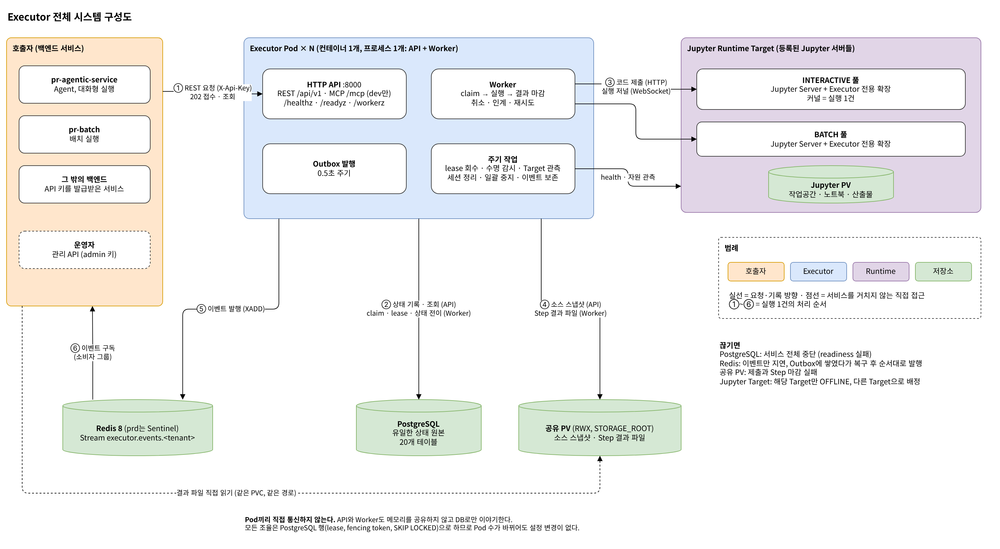
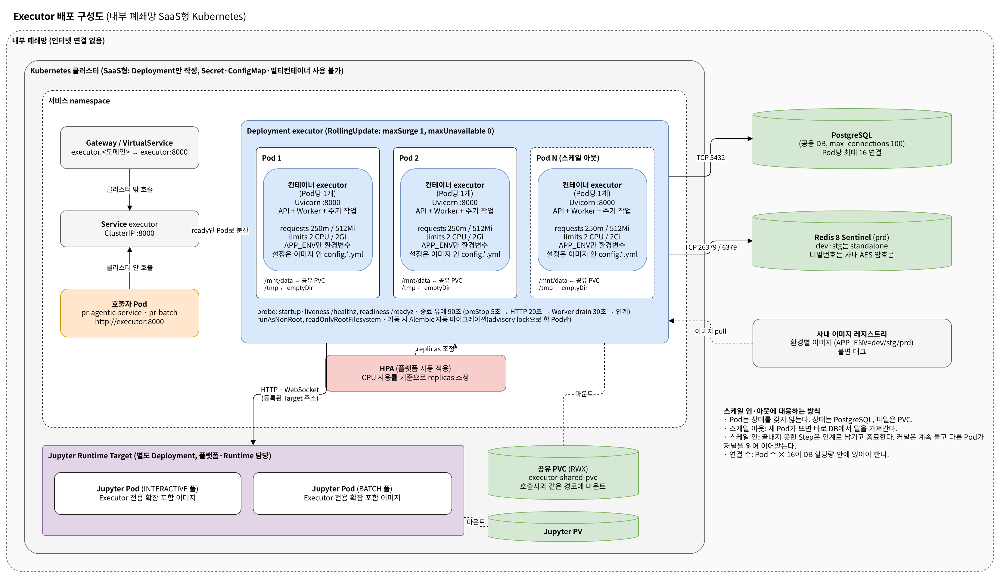

# 전체 시스템 구성도

| 항목 | 내용 |
|---|---|
| 시스템 | Executor (코드 실행 서비스) |
| 산출물 | 1. 전체 시스템 구성도 |
| 버전 | 1.0 |
| 작성일 | 2026-11-25 |
| 기준 | 저장소 `kimhwajin/executor` `main` `3a43a90`, 스키마 리비전 `0017` |

| 버전 | 일자 | 내용 |
|---|---|---|
| 1.0 | 2026-11-25 | 최초 작성 |

Executor는 호출자가 보낸 Python 코드 묶음을 Jupyter 커널에서 비동기로 실행하고, 그 상태와 결과를 보관해 돌려주는 백엔드 서비스다. 이 문서는 Executor가 무엇과 연결되어 있고(논리 구성), 내부 폐쇄망 Kubernetes에 어떻게 올라가는지(배포 구성)를 그림 두 장으로 설명한다. 그림 원본은 `diagrams/01-시스템-구성도.drawio`, `diagrams/01-배포-구성도.drawio`다.

## 1. 논리 구성도

### 1.1 구성 요소

| 구성 요소 | 역할 | 소유 | 끊기면 |
|---|---|---|---|
| 호출자 | REST로 실행을 제출하고 상태·결과를 읽는 백엔드 서비스. 현재 `pr-agentic-service`(Agent), `pr-batch`(배치). API 키를 받은 서비스면 누구나 호출자가 된다 | 각 서비스 | - |
| Executor Pod | API, Worker, 주기 작업이 한 컨테이너의 한 프로세스로 돈다 | Executor | 다른 Pod가 이어받는다(2.3) |
| PostgreSQL | 유일한 상태 원본. Worker 사이의 조율(lease, 행 잠금)도 여기서 한다 | 플랫폼(공용 DB) | 서비스 전체 중단. readiness 실패 |
| Redis 8 | 실행 이벤트 전달 전용. 테넌트별 Stream `executor.events.<tenant>` | 플랫폼 | 이벤트만 지연. Outbox에 쌓였다가 복구 후 순서대로 발행 |
| 공유 PV (`STORAGE_ROOT`) | 소스 스냅샷과 Step 결과 파일. 호출자와 같은 PVC를 같은 경로에 마운트 | 플랫폼 | 제출과 Step 마감 실패 |
| Jupyter Runtime Target | 커널을 띄워 코드를 실제로 실행한다. Executor 전용 확장(`deploy/jupyter/extension`)이 필수 | Runtime 담당 | 해당 Target만 OFFLINE, 다른 Target으로 배정 |
| Jupyter PV | 커널 작업공간, 노트북, 산출물. 공유 PV와 별개 | Runtime 담당 | 노트북·산출물 조회 실패 |

### 1.2 실행 1건의 흐름

1. 호출자가 `POST /api/v1/executions`로 코드를 제출한다. API는 검증하고 PostgreSQL에 기록한 뒤 바로 `202`로 답한다.
2. 같은 프로세스의 Worker가 DB에서 대기 실행을 가져가(claim) 소유권(lease)을 기록한다.
3. Worker가 Jupyter Target을 골라 커널에 코드를 제출하고, 실행 저널을 WebSocket으로 따라 읽는다.
4. Step이 끝날 때마다 출력을 공유 PV에 파일로 마감하고, DB에는 경로와 해시만 남긴다.
5. 상태 변경과 같은 트랜잭션에 기록된 이벤트를 Outbox 발행기가 Redis Stream으로 보낸다.
6. 호출자는 이벤트를 받거나 상태를 조회해 끝난 것을 확인하고, 결과 API나 공유 PV에서 결과를 읽는다.

### 1.3 연결 방식

| 구간 | 프로토콜 | 인증 | 비고 |
|---|---|---|---|
| 호출자 → Executor | HTTP REST (`/api/v1`), dev에서만 MCP(`/mcp`) | `X-Api-Key` (SHA-256 비교), `X-Tenant-Id`, `X-User-Id` | 클러스터 안 `http://executor:8000` |
| Executor → PostgreSQL | TCP 5432 | 계정·비밀번호 | Pod당 최대 16 연결(풀 15 + readiness 1) |
| Executor → Redis | TCP 6379, prd는 Sentinel 26379 | 계정·비밀번호(prd는 사내 AES 암호문) | `PING`, `XADD`, `XTRIM` 권한 |
| Executor → Jupyter | HTTP, WebSocket | Target별 토큰(DB에 Fernet 암호화) | Target은 관리 API로 등록 |
| Executor·호출자 → 공유 PV | 파일시스템(RWX PVC) | - | 모두 같은 경로에 마운트 |
| Redis → 호출자 | Redis Stream 소비자 그룹 | Redis 계정 | at-least-once |

### 1.4 설계 원칙

- **상태 원본은 PostgreSQL 하나.** Worker 메모리나 Redis에 상태를 두지 않는다. 프로세스가 언제 죽어도 DB만 보고 이어갈 수 있다.
- **Pod끼리 직접 통신하지 않는다.** 별도 큐나 분산 락 없이 DB 행(lease, fencing token, `SKIP LOCKED`)으로 조율한다.
- **큰 데이터는 DB에 넣지 않는다.** 코드 본문과 출력은 공유 PV 파일이고 DB에는 경로, 크기, sha256만 둔다.
- **이벤트는 깨우는 신호다.** 상태 변경과 한 트랜잭션으로 기록하고(transactional outbox) 나중에 발행한다. 최종 판단은 조회 API로 한다.

## 2. 배포 구성도

### 2.1 배포 환경의 제약과 대응

| 제약 | Executor의 대응 |
|---|---|
| 멀티컨테이너 불가 | API, Worker, 주기 작업, Outbox 발행을 컨테이너 1개, 프로세스 1개에 넣었다. 사이드카나 별도 Worker Deployment가 없다 |
| Secret·ConfigMap 없음 | 설정은 이미지 안의 `config.yml` + `config.{APP_ENV}.yml`. Deployment는 `APP_ENV`만 준다. 환경별로 이미지를 따로 빌드한다 |
| 마이그레이션 Job 없음 | Pod가 기동할 때 직접 Alembic upgrade를 한다. advisory lock으로 한 Pod만 실행한다 |
| 폐쇄망 | 외부 호출이 없다. 이미지는 사내 레지스트리에서 받고, 의존성은 이미지에 들어 있다 |
| CPU 기준 HPA 자동 적용 | Pod가 상태를 갖지 않으므로 수가 바뀌어도 설정 변경이 없다(2.3) |

### 2.2 Kubernetes 리소스

| 리소스 | 값 | 출처 |
|---|---|---|
| Deployment `executor` | RollingUpdate(maxSurge 1, maxUnavailable 0), 종료 유예 90초, preStop `sleep 5` | `deploy/kubernetes/deployment.yaml` |
| 컨테이너 | 포트 8000, requests 250m / 512Mi, limits 2 CPU / 2Gi, 비루트, 읽기 전용 루트 파일시스템 | 같음 |
| probe | startup·liveness `GET /healthz`, readiness `GET /readyz` | 같음 |
| 볼륨 | 공유 PVC → `/mnt/data`, emptyDir → `/tmp` | 같음 |
| Service `executor` | ClusterIP 8000 | `deploy/kubernetes/service.yaml` |
| 외부 노출 | 플랫폼 Gateway의 VirtualService가 `executor:8000`으로 라우팅 | 플랫폼 |
| HPA | 플랫폼이 CPU 사용률 기준으로 자동 적용 | 플랫폼 |

### 2.3 스케일 인·아웃 대응

| 상황 | 동작 |
|---|---|
| 스케일 아웃 | 새 Pod가 기동 정리 후 1초 주기로 DB에서 대기 실행을 가져간다. 다른 Pod에 알릴 필요가 없다 |
| 스케일 인, 롤링 업데이트 | 새 claim 중단 → 진행 중 실행을 30초 기다림 → 끝내지 못한 Step은 커널에 둔 채 인계로 남기고 종료. 다른 Pod가 실행 저널을 읽어 이어받는다. 사용자 코드는 끊기지 않는다 |
| Pod 비정상 종료 | lease(60초)가 만료되면 다른 Pod의 회수 작업(15초 주기)이 인계하거나 실패로 처리한다 |
| 한계 | DB 연결은 Pod 수 × 16으로 늘어난다. 공용 DB 할당량이 Pod 수의 상한이다. Runtime 용량과 공유 PV 쓰기 속도는 Pod를 늘려도 나아지지 않는다 |

자세한 처리 순서는 프로그램 명세서의 처리 흐름 5(Worker 인계와 회수), 운영 절차는 운영자 매뉴얼 3장에 있다.
