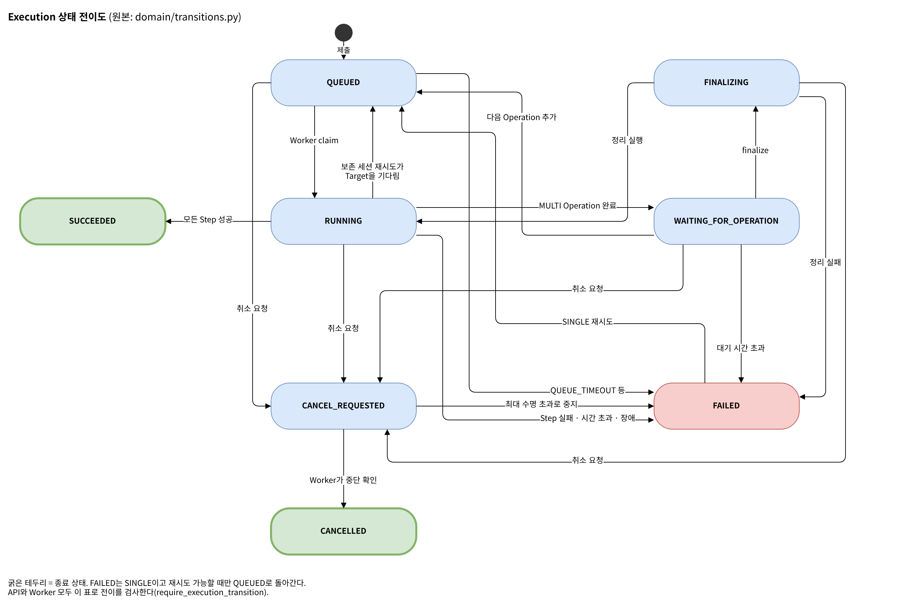
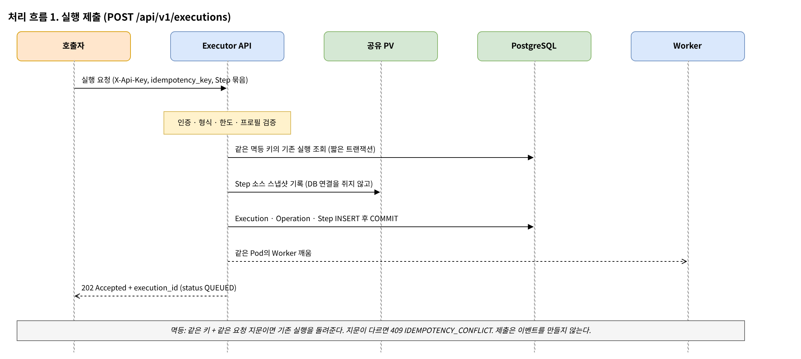
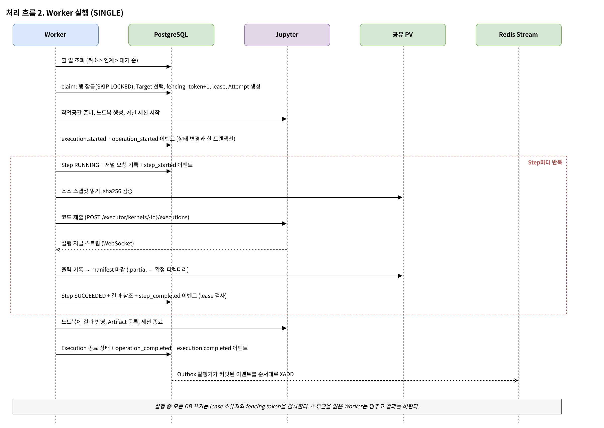
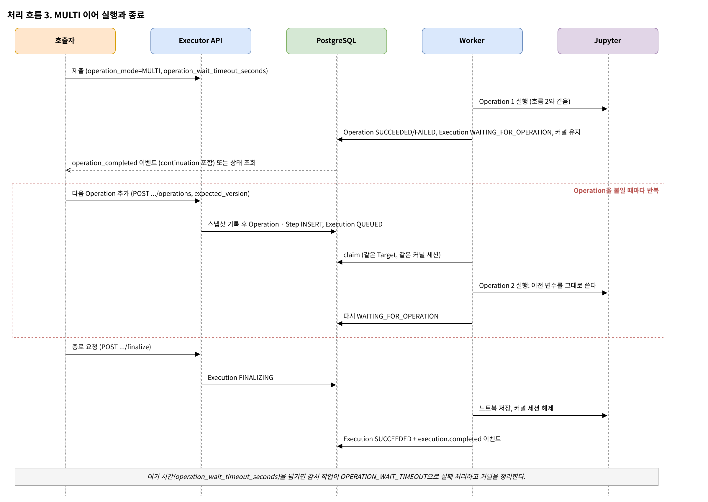
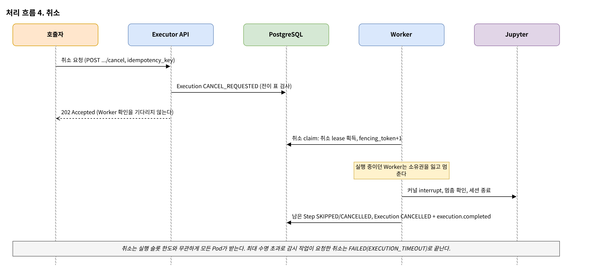
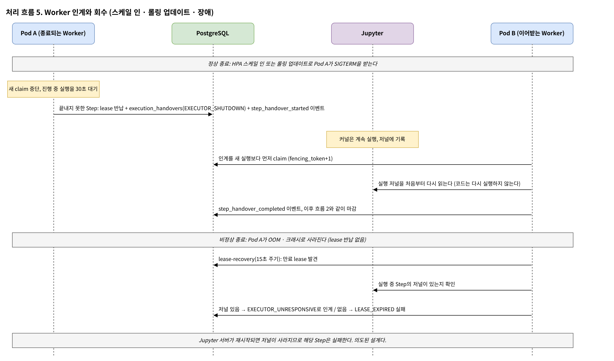
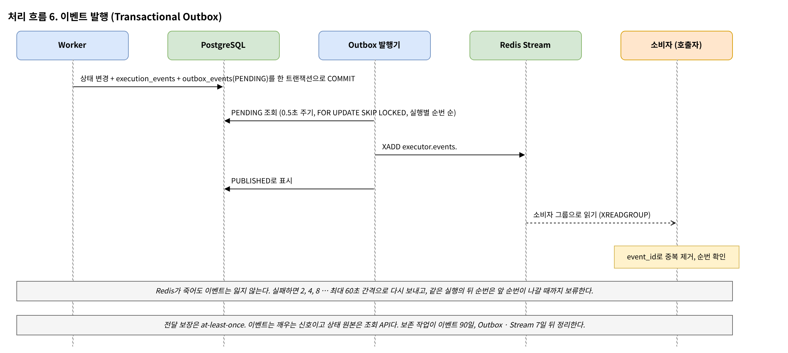

# 프로그램 명세서

| 항목 | 내용 |
|---|---|
| 시스템 | Executor (코드 실행 서비스) |
| 산출물 | 3. 프로그램 명세서 |
| 버전 | 1.0 |
| 작성일 | 2026-11-25 |
| 기준 | 저장소 `kimhwajin/executor` `main` `3a43a90`, 스키마 리비전 `0017` |

| 버전 | 일자 | 내용 |
|---|---|---|
| 1.0 | 2026-11-25 | 최초 작성 |

프로그램 목록(산출물 2)의 115개 프로그램이 무엇을 받아 무엇을 하고 무엇을 남기는지 적는다. Executor는 Agent가 아니라 Agent가 호출하는 코드 실행 서비스이므로, Agent Graph에 해당하는 것은 **Execution 상태 전이도**(2장)와 **처리 흐름도 6장**(3장)이다. LLM 호출이나 도구 선택 노드는 없다. 요청·응답 필드 전체는 부록 A~E(API 레퍼런스)에 있다.

## 1. 공통 사항

### 1.1 프로그램 구분과 ID

| ID | 구분 | 개수 | 명세 위치 |
|---|---|---:|---|
| EX-API-001~026 | 실행 API (REST) | 26 | 4.1, 4.2, 부록 A |
| EX-ADM-001~021 | 관리 API (REST, admin 키) | 21 | 4.3, 부록 B |
| EX-HLT-001~003 | 헬스체크 | 3 | 4.4, 부록 C |
| EX-MCP-001~032 | MCP 엔드포인트와 도구 31개 (dev 전용) | 32 | 4.5, 부록 D |
| EX-EVT-001~008 | 발행 이벤트 | 8 | 4.6, 부록 E |
| EX-WRK-001~016 | Worker, 주기 작업, 기동 작업 | 16 | 4.7 |
| EX-JPX-001~006 | Jupyter 확장 | 6 | 4.8 |
| EX-TL-001~003 | 운영 도구 | 3 | 4.9 |

### 1.2 계층 구조

| 계층 | 경로 (`src/executor_service/`) | 책임 | 의존 방향 |
|---|---|---|---|
| domain | `domain/` | 상태 enum, 상태 전이 표, 도메인 모델, 오류 코드, Runtime 드라이버 계약 | 아무것도 import하지 않는다 |
| application | `application/` | 유스케이스: 제출, 취소, 재시도, Operation 추가, 조회 모델 | domain만 |
| infrastructure | `infrastructure/` | DB, Worker, Jupyter, Redis, 파일 저장, 주기 작업 | domain, application |
| interfaces | `interfaces/` | HTTP 라우터, MCP 서버, 요청·응답 계약, 인증 | application, domain |

계층 규칙은 `tests/test_architecture_dependencies.py`가 강제한다. 조립은 `container.py`, 진입점은 `main.py`, 설정은 `settings.py`다.

### 1.3 모든 API에 공통인 규칙

| 항목 | 규칙 |
|---|---|
| 인증 | `X-Api-Key`. `AUTH_CLIENTS`에 등록된 키의 SHA-256과 비교한다. 없거나 틀리면 `401 UNAUTHENTICATED` |
| 테넌트 | 키의 기본 테넌트, 또는 relay 키가 `X-Tenant-Id`로 지정한 테넌트. 허용 밖이면 `403 FORBIDDEN` |
| 사용자 | 쓰기에는 `X-User-Id` 필수. 다른 사용자의 Execution은 존재해도 `404` |
| 멱등 | 모든 POST 명령은 `idempotency_key`를 받는다. 같은 키·같은 요청은 처음 결과를 돌려주고, 같은 키·다른 요청은 `409 IDEMPOTENCY_CONFLICT` |
| 응답 | 명령은 `202 Accepted`(접수). 실행 완료가 아니다 |
| 오류 형식 | `{"error": {"code", "message", "details"}}` 한 가지 |
| 본문 한도 | 30MB. 넘으면 `413 REQUEST_BODY_TOO_LARGE` |

### 1.4 지켜야 할 불변식

1. 상태 원본은 DB 하나다. Worker 메모리나 Redis에 상태를 두지 않는다.
2. 원격 I/O(Jupyter 호출, 파일 기록) 동안 행 잠금이나 DB 연결을 쥐지 않는다.
3. 모든 실행 쓰기는 lease 소유자와 fencing token 검사를 거친다(`require_active_lease`).
4. 상태 전이는 `domain/transitions.py` 표로만 한다.
5. 이벤트는 상태 변경과 같은 트랜잭션에서 만든다.
6. 결과 파일은 불변이다. `.partial`에 쓰고 rename으로 확정한다.
7. 성공한 코드는 다시 실행하지 않는다.

## 2. Execution 상태 전이도

그림은 `domain/transitions.py`의 전이 표에서 자동 생성한다(`scripts/deliverables/states.py`). API 명령과 Worker 모두 이 표로 전이를 검사하므로, 그림에 없는 전이는 코드에서도 일어나지 않는다.

| 상태 | 뜻 | 끝난 상태인가 |
|---|---|---|
| QUEUED | 접수됨. Worker가 가져가기를 기다린다. 대기 사유는 조회 응답의 `state.reason` | 아니오 |
| RUNNING | Worker가 실행 중 | 아니오 |
| WAITING_FOR_OPERATION | MULTI에서 Operation이 끝나 다음 지시를 기다린다. 커널은 살아 있다 | 아니오 |
| FINALIZING | MULTI 종료 요청을 받아 정리를 기다린다 | 아니오 |
| CANCEL_REQUESTED | 취소 요청됨. Worker가 커널을 멈추는 중 | 아니오 |
| SUCCEEDED | 성공 | 예 |
| FAILED | 실패. SINGLE이고 재시도 가능하면 QUEUED로 돌아갈 수 있다 | 예(재시도 전까지) |
| CANCELLED | 취소 완료 | 예 |

## 3. 처리 흐름

### 3.1 실행 제출

코드 본문은 DB에 넣지 않는다. 스냅샷 파일(`executor/executions/<id>/operations/<operation_id>/sources/<step_id>.py`)과 그 sha256, 크기만 `execution_steps`에 남는다. 스냅샷은 DB 연결을 쥐지 않은 채 쓰고, 그다음 짧은 트랜잭션에서 저장한다.

### 3.2 Worker 실행

할 일 선택 순서는 ① 취소(슬롯과 무관하게 모두) ② 다른 Worker가 넘긴 인계(오래된 순) ③ QUEUED·FINALIZING(생성 순)이다. ②③은 Pod당 `EXECUTION_WORKER_MAX_ACTIVE`(기본 20) 안에서만 받는다.

Target은 같은 풀·타입·프로필이고 ACTIVE이며 슬롯과 메모리가 남은 곳 중 **배정 가능 메모리가 가장 큰 곳**을 고른다. 배정 가능 메모리 = 용량 × `RUNTIME_MEMORY_ADMISSION_LIMIT` − 관측된 사용량 − 관측 이후 시작된 커널 수 × 프로필 예약값.

### 3.3 MULTI 이어 실행과 종료

### 3.4 취소

### 3.5 Worker 인계와 회수

HPA의 스케일 인과 롤링 업데이트가 이 흐름을 탄다. Jupyter 확장이 Step마다 실행 저널을 남기므로 Worker가 바뀌어도 커널의 실행은 계속되고, 새 Worker는 저널을 처음부터 다시 읽어 이어받는다. 비정상 종료에서는 최대 약 75초(lease 60초 + 회수 주기 15초) 동안 진행이 멈춘 것처럼 보인다.

### 3.6 이벤트 발행

## 4. 프로그램별 명세

### 4.1 실행 명령 API

상태를 바꾸는 API 5개다. 모두 `X-User-Id`가 필요하고 `202`로 답한다.

**EX-API-001 Execution 제출** — `POST /api/v1/executions`

| 항목 | 내용 |
|---|---|
| 입력 | `idempotency_key`, `lifecycle`(SINGLE/MULTI, MULTI는 대기 시간), `trigger.type`(INTERACTIVE/BATCH → 풀 결정), `runtime`(JUPYTER, 프로필), `operation.spec.steps[]`(sequence, 코드 INLINE 또는 PATH, 시간 제한, lineage), `metadata` |
| 처리 | 3.1. 형식·한도(Operation당 Step 100개, 누적 1000개)·프로필 검증 → 멱등 조회 → 소스 스냅샷 → INSERT |
| 출력 | `202` + `execution_id`, `state.status=QUEUED`, 헤더 `Location` |
| 주요 오류 | `422 REQUEST_VALIDATION_ERROR`, `422 INVALID_EXECUTION_SPEC`, `422 UNSUPPORTED_RUNTIME_PROFILE`, `409 IDEMPOTENCY_CONFLICT`, `413 REQUEST_BODY_TOO_LARGE` |
| 사용 테이블 | `executions`(C), `execution_operations`(C), `execution_steps`(C) |
| 소스 | `interfaces/http/executions/commands.py`, `application/services/submission.py`, `support.py` |

**EX-API-002 취소 요청** — `POST /api/v1/executions/{execution_id}/cancel`

| 항목 | 내용 |
|---|---|
| 입력 | `idempotency_key`, `reason`(선택, 2000자 이하) |
| 처리 | 3.4. 전이 표 검사 후 `CANCEL_REQUESTED`로 바꾸고 바로 돌아온다. 실제 중단은 Worker가 한다 |
| 출력 | `202` + 현재 상태. 이미 `CANCEL_REQUESTED`면 그대로 돌려준다 |
| 주요 오류 | 끝난 상태에는 `409 INVALID_STATE_TRANSITION` |
| 사용 테이블 | `executions`(U) |
| 소스 | `application/services/lifecycle.py` `cancel` |

**EX-API-003 재시도** — `POST /api/v1/executions/{execution_id}/retry`

| 항목 | 내용 |
|---|---|
| 입력 | `idempotency_key` |
| 처리 | 실패한 SINGLE 실행을 같은 Execution·Operation 안에서 다시 QUEUED로 돌린다. 전략(`FROM_FAILED_STEP`, `FROM_START`)과 시작 sequence는 Executor가 정한다 |
| 출력 | `202` + 상태 |
| 주요 오류 | `FAILED`·`SINGLE`·재시도 가능이 아니면 `409 INVALID_STATE_TRANSITION` |
| 사용 테이블 | `executions`(U), `execution_operations`(U), `execution_steps`(U), `execution_retries`(C) |
| 소스 | `application/services/lifecycle.py` `retry` |

**EX-API-004 MULTI 다음 Operation 추가** — `POST /api/v1/executions/{execution_id}/operations`

| 항목 | 내용 |
|---|---|
| 입력 | `idempotency_key`, `expected_version`, `operation.spec.steps[]`(sequence는 기존 Step 수부터 연속) |
| 처리 | 3.3. `WAITING_FOR_OPERATION`인 MULTI 실행에 Step 묶음을 붙이고 QUEUED로 돌린다. 같은 커널을 이어 쓴다 |
| 출력 | `202` + 상태, 헤더 `Location`은 새 Operation |
| 주요 오류 | 상태·버전 불일치 `409`, Step 규칙 위반 `422 INVALID_EXECUTION_SPEC` |
| 사용 테이블 | `executions`(U), `execution_operations`(C), `execution_steps`(C) |
| 소스 | `application/services/operations.py` |

**EX-API-005 MULTI 종료** — `POST /api/v1/executions/{execution_id}/finalize`

| 항목 | 내용 |
|---|---|
| 입력 | `idempotency_key`, `expected_version` |
| 처리 | `FINALIZING`으로 바꾼다. Worker가 노트북 저장과 커널 해제를 마치면 `SUCCEEDED`(실패하면 `COMPLETION_FAILED`로 `FAILED`) |
| 출력 | `202` + `state.status=FINALIZING` |
| 사용 테이블 | `executions`(U) |
| 소스 | `application/services/lifecycle.py` `finalize` |

### 4.2 실행 조회 API

PostgreSQL 원본 상태를 읽는다. 읽기 전용이며 목록은 모두 `cursor`/`limit` 페이지를 쓴다. 노트북과 Artifact 내용은 Jupyter에서 읽어 온다. 필드는 부록 A.

| ID | 프로그램명 | 인터페이스 | MCP 도구 |
|---|---|---|---|
| EX-API-006 | Execution 목록 | `GET /api/v1/executions` | execution_list |
| EX-API-007 | Execution 상태 | `GET /api/v1/executions/{execution_id}` | execution_get |
| EX-API-008 | 커널과 자원 사용량 | `GET /api/v1/executions/{execution_id}/kernel-usage` | execution_kernel_usage |
| EX-API-009 | 통합 결과 | `GET /api/v1/executions/{execution_id}/result` | execution_result_get |
| EX-API-010 | 노트북 페이지 | `GET /api/v1/executions/{execution_id}/notebook` | execution_notebook_read |
| EX-API-011 | 노트북 셀 하나 | `GET /api/v1/executions/{execution_id}/notebook/cells/{cell_index}` | execution_notebook_cell_read |
| EX-API-012 | Operation 목록 | `GET /api/v1/executions/{execution_id}/operations` | execution_operation_list |
| EX-API-013 | 실패 진단 | `GET /api/v1/executions/{execution_id}/diagnostics` | - |
| EX-API-014 | Step 목록 | `GET /api/v1/executions/{execution_id}/steps` | execution_step_list |
| EX-API-015 | Step 상세 | `GET /api/v1/executions/{execution_id}/steps/{step_id}` | - |
| EX-API-016 | Operation 상세 | `GET /api/v1/executions/{execution_id}/operations/{operation_id}` | execution_operation_get |
| EX-API-017 | Operation 결과 | `GET /api/v1/executions/{execution_id}/operations/{operation_id}/result` | execution_operation_result_get |
| EX-API-018 | Operation의 Step 목록 | `GET /api/v1/executions/{execution_id}/operations/{operation_id}/steps` | execution_operation_step_list |
| EX-API-019 | Attempt 목록 | `GET /api/v1/executions/{execution_id}/attempts` | execution_attempt_list |
| EX-API-020 | Attempt 상세 | `GET /api/v1/executions/{execution_id}/attempts/{attempt_id}` | execution_attempt_get |
| EX-API-021 | Attempt의 Step 결과 | `GET /api/v1/executions/{execution_id}/attempts/{attempt_id}/steps` | execution_attempt_step_list |
| EX-API-022 | 이벤트 이력 | `GET /api/v1/executions/{execution_id}/events` | execution_event_list |
| EX-API-023 | Artifact 목록 | `GET /api/v1/executions/{execution_id}/artifacts` | execution_artifact_list |
| EX-API-024 | 텍스트 Artifact 작성 | `POST /api/v1/executions/{execution_id}/artifacts` | execution_artifact_create |
| EX-API-025 | Artifact 상세 | `GET /api/v1/artifacts/{artifact_id}` | execution_artifact_get |
| EX-API-026 | Artifact 다운로드 | `GET /api/v1/artifacts/{artifact_id}/content` | - |

- EX-API-007은 `wait_seconds`(최대 30)를 주면 실행이 `WAITING_FOR_OPERATION`이나 종료 상태가 될 때까지 응답을 붙잡는다. 폴링 횟수를 줄이는 용도다.
- EX-API-024(텍스트 Artifact 작성)만 쓰기다. `execution_artifacts`(C), `command_receipts`(C).
- 소스: `interfaces/http/executions/queries.py` 외, `application/execution_queries.py`, `infrastructure/execution_queries/`.

### 4.3 관리 API

admin 키 전용이다. 변경 요청은 `X-User-Id`와 본문 `idempotency_key`가 필요하다(DELETE 제외). 필드는 부록 B.

| ID | 프로그램명 | 인터페이스 | MCP 도구 |
|---|---|---|---|
| EX-ADM-001 | Target 목록 | `GET /api/v1/runtime-targets` | runtime_target_list |
| EX-ADM-002 | Target 등록·수정 | `POST /api/v1/runtime-targets` | runtime_target_upsert |
| EX-ADM-003 | Pool 요약 | `GET /api/v1/runtime-pools` | - |
| EX-ADM-004 | Target 상세 | `GET /api/v1/runtime-targets/{target_id}` | runtime_target_get |
| EX-ADM-005 | 등록 삭제 | `DELETE /api/v1/runtime-targets/{target_id}` | - |
| EX-ADM-006 | 커널 목록과 자원 사용량 | `GET /api/v1/runtime-targets/{target_id}/kernels` | runtime_target_kernels |
| EX-ADM-007 | 남겨진 커널 삭제 | `DELETE /api/v1/runtime-targets/{target_id}/kernels/{kernel_id}` | runtime_target_kernel_delete |
| EX-ADM-008 | 즉시 점검 | `POST /api/v1/runtime-targets/{target_id}/probe` | runtime_target_probe |
| EX-ADM-009 | 배정 중지(drain) | `POST /api/v1/runtime-targets/{target_id}/drain` | runtime_target_set_state (desired_state=DRAINING) |
| EX-ADM-010 | 배정 재개 | `POST /api/v1/runtime-targets/{target_id}/activate` | runtime_target_set_state (desired_state=ACTIVE) |
| EX-ADM-011 | 비활성화 | `POST /api/v1/runtime-targets/{target_id}/disable` | runtime_target_disable |
| EX-ADM-012 | 유지보수 상태 | `GET /api/v1/maintenance` | - |
| EX-ADM-013 | 전체 수용 중지 | `POST /api/v1/maintenance/drain` | - |
| EX-ADM-014 | 전체 수용 재개 | `POST /api/v1/maintenance/activate` | - |
| EX-ADM-015 | 일괄 중지 Run 생성 | `POST /api/v1/maintenance/runs` | - |
| EX-ADM-016 | Run 상세 | `GET /api/v1/maintenance/runs/{run_id}` | - |
| EX-ADM-017 | Run 대상 목록 | `GET /api/v1/maintenance/runs/{run_id}/targets` | - |
| EX-ADM-018 | Stream 전체 요약 | `GET /api/v1/event-streams` | - |
| EX-ADM-019 | Stream 상세 | `GET /api/v1/event-streams/{tenant_id}` | - |
| EX-ADM-020 | Stream 항목 | `GET /api/v1/event-streams/{tenant_id}/entries` | - |
| EX-ADM-021 | pending 항목 | `GET /api/v1/event-streams/{tenant_id}/groups/{group}/pending` | - |

| 묶음 | 사용 테이블 | 소스 |
|---|---|---|
| Runtime Target·Pool (001~011) | `runtime_targets`(CRUD), `runtime_target_purges`(C), `command_receipts`(C), `execution_attempts`·`executions`(R) | `interfaces/http/runtime_targets.py`, `infrastructure/runtime_registry/` |
| 유지보수 (012~017) | `executor_maintenance`(RU), `maintenance_runs`(CR), `maintenance_run_targets`(CR), `command_receipts`(C) | `interfaces/http/maintenance.py`, `infrastructure/maintenance.py`, `maintenance_runs/` |
| 이벤트 Stream 조회 (018~021) | 없음(Redis를 읽는다: `EXISTS`, `XINFO`, `XREVRANGE`, `XRANGE`, `XPENDING`) | `interfaces/http/event_streams.py`, `infrastructure/event_stream_inspector.py` |

### 4.4 헬스체크

| ID | 인터페이스 | 판정 | 인증 |
|---|---|---|---|
| EX-HLT-001 | `GET /healthz` | 항상 `200`. 프로세스가 응답하는지 | 없음 |
| EX-HLT-002 | `GET /readyz` | 별도 연결로 2초 안에 `alembic_version`이 `0017` 이상인지, Worker가 claim을 받는 상태인지. 하나라도 아니면 `503` | 없음 |
| EX-HLT-003 | `GET /workerz` | 이 Pod의 Worker 상태, 실행 수, Redis 도달 여부, 기동 정리 결과 | admin 키 |

Redis 장애와 DB 풀이 바쁜 것은 readiness에 넣지 않는다. 이벤트만 늦어지거나 부하일 뿐 장애가 아니기 때문이다.

### 4.5 MCP

EX-MCP-001은 `POST /mcp` 진입점이고 EX-MCP-002~032가 도구 31개다. 도구는 REST와 같은 application 서비스를 부르므로 동작과 오류가 REST와 같다. dev에서만 켜고 stg·prd에서는 꺼져 있다(404). 도구별 인자는 부록 D.

### 4.6 이벤트

Stream `executor.events.<tenant>`에 발행한다. 스키마 버전 `1.0`, at-least-once. payload는 부록 E.

| ID | event_type | 언제 |
|---|---|---|
| EX-EVT-001 | `execution.started` | Worker가 처음 실행을 맡고 커널을 준비했을 때 한 번 |
| EX-EVT-002 | `execution.operation_started` | Operation 실행 시작 |
| EX-EVT-003 | `execution.step_started` | Step 실행 시작(시도마다) |
| EX-EVT-004 | `execution.step_handover_started` | Worker 종료·무응답으로 실행 중 Step의 관찰이 끊겼다. 커널은 계속 돈다 |
| EX-EVT-005 | `execution.step_handover_completed` | 다른 Worker가 저널을 복원해 이어서 관찰한다 |
| EX-EVT-006 | `execution.step_completed` | Step 종료. 성공이면 결과 참조가 있다 |
| EX-EVT-007 | `execution.operation_completed` | Operation 종료. MULTI는 이어 붙일 수 있는지가 담긴다 |
| EX-EVT-008 | `execution.completed` | Execution 종료(마지막 이벤트) |

### 4.7 Worker와 주기 작업

| ID | 프로그램 | 실행 위치·주기 | 처리 | 사용 테이블 |
|---|---|---|---|---|
| EX-WRK-001 | execution-reconciler | 모든 Pod, 1초(명령 접수 시 즉시) | 할 일을 claim해 실행 작업으로 띄운다. claim은 행 잠금, Target 선택, fencing_token+1, lease 기록, Attempt 생성 | `executions`(RU), `execution_attempts`(C), `execution_handovers`(RD), `runtime_targets`(R), `executor_maintenance`(R) |
| EX-WRK-002 | SINGLE 실행 | claim마다 | 3.2. Step을 순서대로 실행하고 커널을 정리한다 | `execution_steps`(U), `execution_step_attempts`(C), `execution_step_runs`(C), `execution_operations`(U), 이벤트 테이블(C) |
| EX-WRK-003 | MULTI 실행 | claim마다 | 3.3. Operation을 실행하고 커널을 유지한다 | 위와 같음 |
| EX-WRK-004 | 취소 처리 | CANCEL_REQUESTED마다 | 3.4. 취소 lease로 소유권을 가져와 커널을 멈춘다 | `executions`(U), `execution_attempts`(U), `execution_steps`(U), `execution_step_attempts`(U) |
| EX-WRK-005 | 인계 이어받기 | 인계 대기마다 | 3.5. 저널을 다시 읽어 이어서 관찰한다 | `execution_handovers`(D), `execution_step_runs`(R), `execution_step_attempts`(U) |
| EX-WRK-006 | lease heartbeat | 실행마다, 15초 | lease를 60초 연장하고 소유권을 확인한다 | `executions`(U) |
| EX-WRK-007 | 노트북 반영 | Operation마다 | Step 결과를 실행 노트북에 반영한다 | `executions`(U) |
| EX-WRK-008 | Outbox 발행 | 모든 Pod, 0.5초 | 3.6 | `outbox_events`(RU) |
| EX-WRK-009 | lease-recovery | 클러스터 1개 Pod, 15초 | 만료 lease를 회수해 인계 또는 `LEASE_EXPIRED` 실패로 처리하고 버려진 세션을 정리한다 | `executions`(U), `execution_handovers`(C), `execution_diagnostics`(C) |
| EX-WRK-010 | retained-session-cleanup | 클러스터 1개 Pod, 15초 | 보존 기간(1시간)이 지난 실패 세션을 삭제한다 | `executions`(U), `execution_attempts`(U) |
| EX-WRK-011 | multi-lifecycle-audit | 클러스터 1개 Pod, 15초 | `QUEUE_TIMEOUT`(24시간), `EXECUTION_TIMEOUT`(7일), `OPERATION_WAIT_TIMEOUT`을 처리한다 | `executions`(U) |
| EX-WRK-012 | maintenance-runs | 클러스터 1개 Pod, 15초 | 일괄 중지 Run을 진행한다 | `maintenance_runs`(U), `maintenance_run_targets`(U) |
| EX-WRK-013 | runtime-health | 클러스터 1개 Pod, 15초 | Target의 health, 세션 수, CPU, 메모리를 관측하고 ACTIVE↔OFFLINE을 바꾼다 | `runtime_targets`(U) |
| EX-WRK-014 | events 보존 | 클러스터 1개 Pod, 600초 | 이벤트(90일), 발행된 Outbox(7일), Redis Stream 항목(7일)을 정리한다 | `execution_events`(D), `outbox_events`(D) |
| EX-WRK-015 | DB 마이그레이션 | 기동 시 | advisory lock을 잡은 Pod가 Alembic upgrade | `alembic_version` |
| EX-WRK-016 | startup reconciliation | 기동 시 | claim 시작 전에 만료 lease를 정리한다 | `executions`(U) |

"클러스터 1개 Pod"는 `event_retention_lease` 테이블의 키별 행을 먼저 잡은 Pod가 그 주기를 실행한다는 뜻이다(`infrastructure/cluster_passes.py`). 겹쳐 실행돼도 안전하고, 이 잠금은 부하를 줄이는 용도다. 그래서 Pod가 늘어도 주기 작업의 부하는 늘지 않는다.

실패 유형과 재시도 가능 여부는 `execution_worker/failure_policy.py`가 정한다.

| 실패 유형 | 의미 | 재시도 |
|---|---|---|
| `TOOL_ERROR` | 사용자 코드 예외 | 커널을 1시간 보존, 실패한 Step부터(`FROM_FAILED_STEP`) |
| `STEP_TIMEOUT`, `OPERATION_TIMEOUT`, `OUTPUT_LIMIT_EXCEEDED` | 시간·출력 한도 초과 | 커널 중단 결과에 따라 |
| `RUNTIME_UNAVAILABLE`, `RUNTIME_SESSION_LOST` | Jupyter 연결 실패, 커널 사라짐 | `FROM_START` 또는 불가 |
| `WORKER_SHUTDOWN`, `LEASE_EXPIRED` | Worker가 멈췄고 인계할 수 없었음 | SINGLE은 `FROM_START`, MULTI는 불가 |
| `QUEUE_TIMEOUT`, `EXECUTION_TIMEOUT`, `OPERATION_WAIT_TIMEOUT` | 대기·수명 초과 | 불가 |
| `COMPLETION_FAILED`, `INFRASTRUCTURE_ERROR`, `INTERNAL_ERROR` | 결과 마감, 저장소, 내부 오류 | 상황별 |

### 4.8 Jupyter 확장

Jupyter 서버 안에서 도는 Executor 전용 확장이다(`deploy/jupyter/extension/`). Executor의 Worker만 호출한다. 확장 없이는 코드를 실행하지 못한다(시작 요청이 404).

| ID | 프로그램 | 인터페이스 | 처리 |
|---|---|---|---|
| EX-JPX-001 | 코드 실행 시작 | `POST /executor/kernels/{id}/executions` | 커널에 코드를 제출하고 실행 저널(JSONL)을 만든다 |
| EX-JPX-002 | 실행 저널 삭제 | `DELETE /executor/kernels/{id}/executions/{request_id}` | 확정된 Step의 저널을 지운다 |
| EX-JPX-003 | 실행 저널 스트림 | WebSocket `.../executions/{request_id}/stream` | 저널을 처음부터 내보낸다. 인계 때 새 Worker가 여기로 붙는다 |
| EX-JPX-004 | 자원 상태 | `GET /executor/resource-status` | 서버의 CPU, 메모리, 세션 수 |
| EX-JPX-005 | 커널별 사용량 | `GET /executor/kernel-usage` | 커널별 메모리와 CPU 시간 |
| EX-JPX-006 | 작업공간·노트북·파일 | `/executor/storage/...` | 작업공간 준비, 노트북 생성·반영, 산출물 스냅샷, 파일·manifest 읽기 |

### 4.9 운영 도구

| ID | 프로그램 | 실행 | 용도 |
|---|---|---|---|
| EX-TL-001 | API 키 발급 | `python3 scripts/generate_api_keys.py <env>` | 호출자별 키와 `AUTH_CLIENTS`에 넣을 SHA-256 |
| EX-TL-002 | 품질 게이트 | `uv run python scripts/quality_gate.py` | lint, 타입, 테스트, 마이그레이션 검사 |
| EX-TL-003 | 산출물 생성 | `scripts/deliverables/*.py` | 물리 ERD, Table 정의서, 프로그램 목록, 상태 전이도를 코드에서 생성 |

## 5. 프로그램과 테이블 대응

C 생성, R 조회, U 수정, D 삭제. 소스가 참조하는 ORM 모델을 기준으로 정리했다.

| 테이블 | 제출·Operation 추가 | 취소·재시도·종료 명령 | Worker 실행 | 취소 처리 | 인계·회수 | Outbox·보존 | 관리 API | 조회 API |
|---|---|---|---|---|---|---|---|---|
| `executions` | C | U | RU | U | U | R | R | R |
| `execution_operations` | C | U | U | U | U | | | R |
| `execution_steps` | C | U | U | U | U | | | R |
| `execution_attempts` | | | CU | U | U | | R | R |
| `execution_step_attempts` | | | CU | U | U | | | R |
| `execution_step_runs` | | | C | | R | | | |
| `execution_handovers` | | | D | | CD | | | R |
| `execution_retries` | | C | | | | | | |
| `execution_artifacts` | | | C | | | | | CR |
| `execution_diagnostics` | | | C | | C | | | R |
| `execution_event_sequences` | | | CU | U | U | | | |
| `execution_events` | | | C | C | C | D | | R |
| `outbox_events` | | | C | C | C | RUD | | R |
| `runtime_targets` | | | RU | R | R | | CRUD | R |
| `runtime_target_purges` | | | | | | | C | |
| `executor_maintenance` | | | R | | | | RU | |
| `maintenance_runs`, `maintenance_run_targets` | | | | | | | CRU | |
| `event_retention_lease` | | | | | U | U | | |
| `command_receipts` | | | | | | | C | C |
