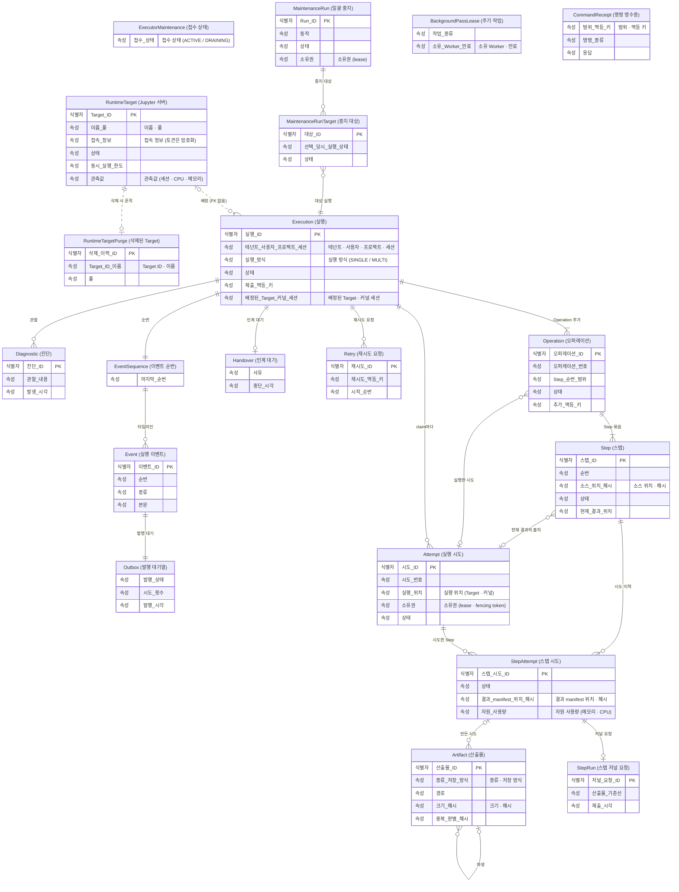

# 논리 ERD

| 항목 | 내용 |
|---|---|
| 시스템 | Executor (코드 실행 서비스) |
| 산출물 | 4. 논리 ERD |
| 버전 | 1.1 |
| 작성일 | 2026-11-25 |
| 기준 | 저장소 `kimhwajin/executor` `main` `3a43a90`, 스키마 리비전 `0017` |

| 버전 | 일자 | 내용 |
|---|---|---|
| 1.0 | 2026-11-25 | 최초 작성 |
| 1.1 | 2026-11-27 | Markdown에 텍스트 ERD(6장) 추가 |

Executor의 데이터는 8개 업무 영역, 20개 엔터티로 이루어진다. 중심은 `Execution > Operation > Step`(요청한 것)과 `Attempt > StepAttempt`(실제로 돌린 것)의 두 축이다. 그림 원본은 `diagrams/04-논리-ERD.drawio`다.

## 1. 논리 ERD

## 2. 업무 영역과 엔터티

| 영역 | 엔터티 | 설명 |
|---|---|---|
| 실행 요청 | Execution, Operation, Step | 호출자가 요청한 것. Execution 하나에 Operation 1개 이상(MULTI는 계속 추가), Operation 하나에 Step 1~100개 |
| 실행 시도 | Attempt, StepAttempt, Retry | 실제로 돌린 기록. claim 한 번이 Attempt 하나. 재시도와 Worker 교체마다 늘어난다 |
| 인계 | StepRun, Handover | Step 시도의 Jupyter 저널 요청(인계 시 새 Worker가 따라 읽을 대상)과, 다른 Worker를 기다리는 인계 표시 |
| 결과 | Artifact, Diagnostic | 작업공간 산출물 등록, 실패·누락 관찰 기록 |
| 이벤트 | Event, EventSequence, Outbox | 실행 타임라인(조회 API용)과 Redis 발행 대기열 |
| Runtime | RuntimeTarget, RuntimeTargetPurge | Jupyter 서버 등록과 관측값, 삭제된 Target의 흔적 |
| 운영 | ExecutorMaintenance, MaintenanceRun, MaintenanceRunTarget, BackgroundPassLease | 접수 중단, 실행 일괄 중지, 주기 작업 단일 실행 |
| 멱등 | CommandReceipt | 관리 명령과 Artifact 생성의 재요청 응답 |

## 3. 관계

| 관계 | 카디널리티 | 의미 |
|---|---|---|
| Execution – Operation | 1 : 1..N | SINGLE은 1개, MULTI는 추가할 때마다 1개 |
| Operation – Step | 1 : 1..N | 한 번에 제출한 Step 묶음(최대 100) |
| Execution – Attempt | 1 : 0..N | Worker가 claim할 때마다 1개 |
| Attempt – StepAttempt, Step – StepAttempt | 1 : 0..N | 어떤 시도에서 어떤 Step을 돌렸는가 |
| Step – Attempt | N : 0..1 | Step의 현재 결과가 나온 시도 |
| Operation – Attempt | N : 0..1 | Operation을 실행한 시도 |
| StepAttempt – StepRun | 1 : 0..1 | Jupyter에 낸 저널 요청 |
| Execution – Handover | 1 : 0..1 | 인계를 기다리는 동안만 존재 |
| Execution – Retry | 1 : 0..N | 호출자의 재시도 요청 |
| Execution – EventSequence | 1 : 1 | 실행별 이벤트 순번 카운터 |
| Execution – Event – Outbox | 1 : 0..N, 1 : 1 | 타임라인과 그 발행 대기 |
| StepAttempt – Artifact, Artifact – Artifact | 0..1 : 0..N | 산출물을 만든 시도, 파생 산출물 |
| RuntimeTarget – Execution·Attempt | 0..1 : 0..N, 참조 무결성 없음 | Target을 삭제해도 실행 이력이 남아야 하므로 값으로만 참조. 삭제된 Target은 RuntimeTargetPurge로 해석 |
| MaintenanceRun – MaintenanceRunTarget – Execution | 1 : 0..N, N : 1 | 일괄 중지 요청과 그 대상 실행 |

## 4. 상태

Execution의 상태 전이는 프로그램 명세서의 상태 전이도에 있다. 나머지 엔터티의 상태값은 아래와 같다.

| 엔터티 | 상태값 |
|---|---|
| Operation | QUEUED, RUNNING, SUCCEEDED, FAILED, CANCELLED |
| Step, StepAttempt | PENDING, RUNNING, SUCCEEDED, FAILED, SKIPPED, CANCELLED |
| Attempt | RUNNING, WAITING(MULTI가 다음 Operation 대기), SUCCEEDED, FAILED, CANCELLED |
| RuntimeTarget | ACTIVE(배정), DRAINING(새 배정 중단), OFFLINE(probe 실패, 자동 복귀) |
| Outbox | PENDING, PUBLISHED |
| ExecutorMaintenance | ACTIVE, DRAINING |
| MaintenanceRun | REQUESTED, RUNNING, SUCCEEDED, FAILED |
| MaintenanceRunTarget | PENDING, STOP_REQUESTED, STOPPED, FAILED |

## 5. 식별과 멱등

| 대상 | 유일 키 |
|---|---|
| Execution 제출 | (테넌트, 멱등 키) + 요청 지문 비교 |
| Operation 추가, 재시도 | (Execution, 멱등 키) |
| 취소 | Execution의 취소 멱등 키 |
| 관리 명령, Artifact 생성 | (범위, 멱등 키) in CommandReceipt |
| Artifact 중복 등록 | 중복 판별 해시 |
| Jupyter 저널 요청 | 저널 요청 ID |

<!-- md-only:start -->

<!-- 여기부터 md-only:end까지는 Markdown에만 있다. Word 제출본에는 넣지 않는다. 그림(`diagrams/04-논리-ERD.drawio`)을 고치면 여기도 함께 고친다. -->

## 6. 텍스트 ERD

그림과 같은 내용을 글로 적은 것이다. 엔터티 20개와 그 속성, 관계 20개를 모두 담았다. Mermaid를 그려 주는 화면(GitHub 등)에서는 6.1이 그림으로 보인다.

### 6.1 논리 ERD

실선은 참조 무결성(FK)이 있는 관계, 점선은 값으로만 참조하는 관계다. `PK`는 식별자다.

### 6.2 엔터티와 속성

`#`는 식별자다. 물리 테이블 열은 그 엔터티가 구현된 테이블이며, 컬럼 전체는 물리 ERD와 Table 정의서에 있다.

#### 6.2.1 Execution (실행)

실행 요청 영역. 물리 테이블 `executions`.

| No | 속성 | 식별자 |
|---|---|---|
| 1 | 실행 ID | # |
| 2 | 테넌트 · 사용자 · 프로젝트 · 세션 |  |
| 3 | 실행 방식 (SINGLE / MULTI) |  |
| 4 | 상태 |  |
| 5 | 제출 멱등 키 |  |
| 6 | 배정된 Target · 커널 세션 |  |

#### 6.2.2 Operation (오퍼레이션)

실행 요청 영역. 물리 테이블 `execution_operations`.

| No | 속성 | 식별자 |
|---|---|---|
| 1 | 오퍼레이션 ID | # |
| 2 | 오퍼레이션 번호 |  |
| 3 | Step 순번 범위 |  |
| 4 | 상태 |  |
| 5 | 추가 멱등 키 |  |

#### 6.2.3 Step (스텝)

실행 요청 영역. 물리 테이블 `execution_steps`.

| No | 속성 | 식별자 |
|---|---|---|
| 1 | 스텝 ID | # |
| 2 | 순번 |  |
| 3 | 소스 위치 · 해시 |  |
| 4 | 상태 |  |
| 5 | 현재 결과 위치 |  |

#### 6.2.4 Attempt (실행 시도)

실행 시도 영역. 물리 테이블 `execution_attempts`.

| No | 속성 | 식별자 |
|---|---|---|
| 1 | 시도 ID | # |
| 2 | 시도 번호 |  |
| 3 | 실행 위치 (Target · 커널) |  |
| 4 | 소유권 (lease · fencing token) |  |
| 5 | 상태 |  |

#### 6.2.5 StepAttempt (스텝 시도)

실행 시도 영역. 물리 테이블 `execution_step_attempts`.

| No | 속성 | 식별자 |
|---|---|---|
| 1 | 스텝 시도 ID | # |
| 2 | 상태 |  |
| 3 | 결과 manifest 위치 · 해시 |  |
| 4 | 자원 사용량 (메모리 · CPU) |  |

#### 6.2.6 Retry (재시도 요청)

실행 시도 영역. 물리 테이블 `execution_retries`.

| No | 속성 | 식별자 |
|---|---|---|
| 1 | 재시도 ID | # |
| 2 | 재시도 멱등 키 |  |
| 3 | 시작 순번 |  |

#### 6.2.7 StepRun (스텝 저널 요청)

인계 영역. 물리 테이블 `execution_step_runs`.

| No | 속성 | 식별자 |
|---|---|---|
| 1 | 저널 요청 ID | # |
| 2 | 산출물 기준선 |  |
| 3 | 제출 시각 |  |

#### 6.2.8 Handover (인계 대기)

인계 영역. 물리 테이블 `execution_handovers`.

| No | 속성 | 식별자 |
|---|---|---|
| 1 | 사유 |  |
| 2 | 중단 시각 |  |

#### 6.2.9 Artifact (산출물)

결과 영역. 물리 테이블 `execution_artifacts`.

| No | 속성 | 식별자 |
|---|---|---|
| 1 | 산출물 ID | # |
| 2 | 종류 · 저장 방식 |  |
| 3 | 경로 |  |
| 4 | 크기 · 해시 |  |
| 5 | 중복 판별 해시 |  |

#### 6.2.10 Diagnostic (진단)

결과 영역. 물리 테이블 `execution_diagnostics`.

| No | 속성 | 식별자 |
|---|---|---|
| 1 | 진단 ID | # |
| 2 | 관찰 내용 |  |
| 3 | 발생 시각 |  |

#### 6.2.11 Event (실행 이벤트)

이벤트 영역. 물리 테이블 `execution_events`.

| No | 속성 | 식별자 |
|---|---|---|
| 1 | 이벤트 ID | # |
| 2 | 순번 |  |
| 3 | 종류 |  |
| 4 | 본문 |  |

#### 6.2.12 EventSequence (이벤트 순번)

이벤트 영역. 물리 테이블 `execution_event_sequences`.

| No | 속성 | 식별자 |
|---|---|---|
| 1 | 마지막 순번 |  |

#### 6.2.13 Outbox (발행 대기열)

이벤트 영역. 물리 테이블 `outbox_events`.

| No | 속성 | 식별자 |
|---|---|---|
| 1 | 발행 상태 |  |
| 2 | 시도 횟수 |  |
| 3 | 발행 시각 |  |

#### 6.2.14 RuntimeTarget (Jupyter 서버)

Runtime 영역. 물리 테이블 `runtime_targets`.

| No | 속성 | 식별자 |
|---|---|---|
| 1 | Target ID | # |
| 2 | 이름 · 풀 |  |
| 3 | 접속 정보 (토큰은 암호화) |  |
| 4 | 상태 |  |
| 5 | 동시 실행 한도 |  |
| 6 | 관측값 (세션 · CPU · 메모리) |  |

#### 6.2.15 RuntimeTargetPurge (삭제된 Target)

Runtime 영역. 물리 테이블 `runtime_target_purges`.

| No | 속성 | 식별자 |
|---|---|---|
| 1 | 삭제 이력 ID | # |
| 2 | Target ID · 이름 |  |
| 3 | 풀 |  |

#### 6.2.16 ExecutorMaintenance (접수 상태)

운영 영역. 물리 테이블 `executor_maintenance`.

| No | 속성 | 식별자 |
|---|---|---|
| 1 | 접수 상태 (ACTIVE / DRAINING) |  |

#### 6.2.17 MaintenanceRun (일괄 중지)

운영 영역. 물리 테이블 `maintenance_runs`.

| No | 속성 | 식별자 |
|---|---|---|
| 1 | Run ID | # |
| 2 | 동작 |  |
| 3 | 상태 |  |
| 4 | 소유권 (lease) |  |

#### 6.2.18 MaintenanceRunTarget (중지 대상)

운영 영역. 물리 테이블 `maintenance_run_targets`.

| No | 속성 | 식별자 |
|---|---|---|
| 1 | 대상 ID | # |
| 2 | 선택 당시 실행 상태 |  |
| 3 | 상태 |  |

#### 6.2.19 BackgroundPassLease (주기 작업)

운영 영역. 물리 테이블 `event_retention_lease`.

| No | 속성 | 식별자 |
|---|---|---|
| 1 | 작업 종류 |  |
| 2 | 소유 Worker · 만료 |  |

#### 6.2.20 CommandReceipt (명령 영수증)

멱등 영역. 물리 테이블 `command_receipts`.

| No | 속성 | 식별자 |
|---|---|---|
| 1 | 범위 · 멱등 키 |  |
| 2 | 명령 종류 |  |
| 3 | 응답 |  |

### 6.3 관계

| No | 엔터티 A | A 쪽 | B 쪽 | 엔터티 B | 관계 이름 | 참조 무결성 |
|---|---|---|---|---|---|---|
| 1 | Execution | 1 | 1..N | Operation | Operation 추가 | FK |
| 2 | Operation | 1 | 1..N | Step | Step 묶음 | FK |
| 3 | Execution | 1 | 0..N | Attempt | claim마다 | FK |
| 4 | Execution | 1 | 0..N | Retry | 재시도 요청 | FK |
| 5 | Attempt | 1 | 0..N | StepAttempt | 시도한 Step | FK |
| 6 | Step | 1 | 0..N | StepAttempt | 시도 이력 | FK |
| 7 | Operation | 0..N | 0..1 | Attempt | 실행한 시도 | FK |
| 8 | Step | 0..N | 0..1 | Attempt | 현재 결과의 출처 | FK |
| 9 | StepAttempt | 1 | 0..1 | StepRun | 저널 요청 | FK |
| 10 | Execution | 1 | 0..1 | Handover | 인계 대기 | FK |
| 11 | Execution | 1 | 1 | EventSequence | 순번 | FK |
| 12 | EventSequence | 1 | 0..N | Event | 타임라인 | FK |
| 13 | Event | 1 | 1 | Outbox | 발행 대기 | FK |
| 14 | Execution | 1 | 0..N | Diagnostic | 관찰 | FK |
| 15 | StepAttempt | 0..1 | 0..N | Artifact | 만든 시도 | FK |
| 16 | Artifact | 0..1 | 0..N | Artifact | 파생 | FK |
| 17 | RuntimeTarget | 0..1 | 0..N | Execution | 배정 (FK 없음) | 없음 (값으로만 참조) |
| 18 | RuntimeTarget | 1 | 0..1 | RuntimeTargetPurge | 삭제 시 흔적 | 없음 (값으로만 참조) |
| 19 | MaintenanceRun | 1 | 0..N | MaintenanceRunTarget | 중지 대상 | FK |
| 20 | MaintenanceRunTarget | 0..N | 1 | Execution | 대상 실행 | FK |

A 하나에 B가 "B 쪽" 개수만큼, B 하나에 A가 "A 쪽" 개수만큼 대응한다. Execution은 Attempt, StepAttempt, Artifact, Event에도 직접 연결된다(조회 단축용 실행 ID). 여기에는 그림과 같이 상위 관계만 적었다.

<!-- md-only:end -->
