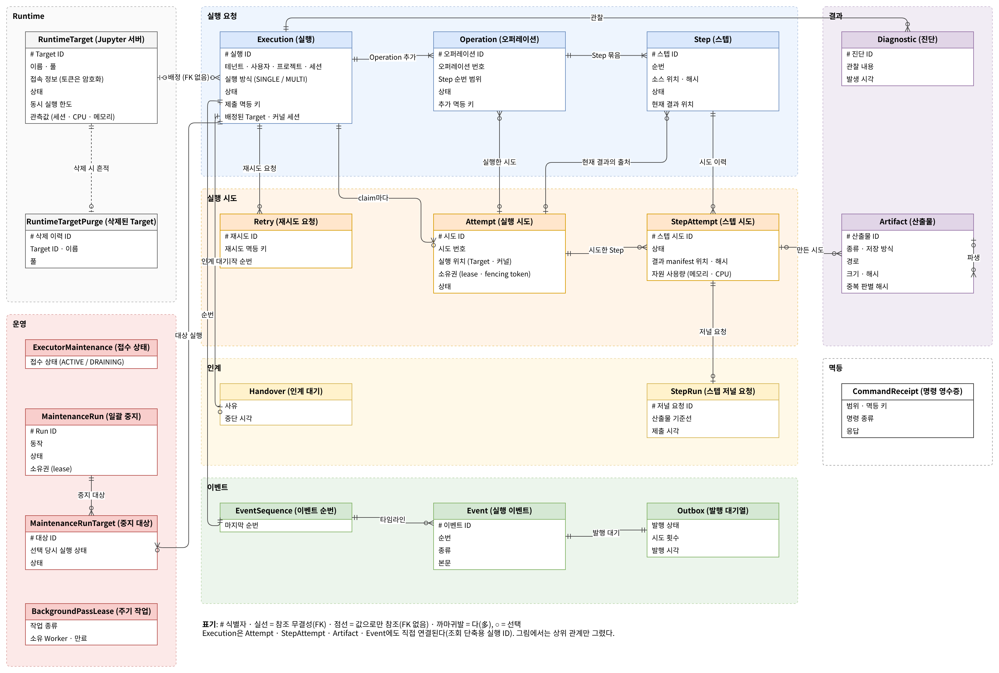

# 논리 ERD

| 항목 | 내용 |
|---|---|
| 시스템 | Executor (코드 실행 서비스) |
| 산출물 | 4. 논리 ERD |
| 버전 | 1.0 |
| 작성일 | 2026-11-25 |
| 기준 | 저장소 `kimhwajin/executor` `main` `3a43a90`, 스키마 리비전 `0017` |

| 버전 | 일자 | 내용 |
|---|---|---|
| 1.0 | 2026-11-25 | 최초 작성 |

Executor의 데이터는 8개 업무 영역, 20개 엔터티로 이루어진다. 중심은 `Execution > Operation > Step`(요청한 것)과 `Attempt > StepAttempt`(실제로 돌린 것)의 두 축이다. 그림 원본은 `diagrams/04-논리-ERD.drawio`다.

## 1. 논리 ERD

## 2. 업무 영역과 엔터티

| 영역 | 엔터티 | 설명 |
|---|---|---|
| 실행 요청 | Execution, Operation, Step | 호출자가 요청한 것. Execution 하나에 Operation 1개 이상(MULTI는 계속 추가), Operation 하나에 Step 1~100개 |
| 실행 시도 | Attempt, StepAttempt, Retry | 실제로 돌린 기록. claim 한 번이 Attempt 하나. 재시도와 Worker 교체마다 늘어난다 |
| 인계 | StepRun, Handover | Step 시도의 Jupyter 저널 요청(인계 시 새 Worker가 따라 읽을 대상)과, 다른 Worker를 기다리는 인계 표시 |
| 결과 | Artifact, Diagnostic | 작업공간 산출물 등록, 실패·누락 관찰 기록 |
| 이벤트 | Event, EventSequence, Outbox | 실행 타임라인(조회 API용)과 Redis 발행 대기열 |
| Runtime | RuntimeTarget, RuntimeTargetPurge | Jupyter 서버 등록과 관측값, 삭제된 Target의 흔적 |
| 운영 | ExecutorMaintenance, MaintenanceRun, MaintenanceRunTarget, BackgroundPassLease | 접수 중단, 실행 일괄 중지, 주기 작업 단일 실행 |
| 멱등 | CommandReceipt | 관리 명령과 Artifact 생성의 재요청 응답 |

## 3. 관계

| 관계 | 카디널리티 | 의미 |
|---|---|---|
| Execution – Operation | 1 : 1..N | SINGLE은 1개, MULTI는 추가할 때마다 1개 |
| Operation – Step | 1 : 1..N | 한 번에 제출한 Step 묶음(최대 100) |
| Execution – Attempt | 1 : 0..N | Worker가 claim할 때마다 1개 |
| Attempt – StepAttempt, Step – StepAttempt | 1 : 0..N | 어떤 시도에서 어떤 Step을 돌렸는가 |
| Step – Attempt | N : 0..1 | Step의 현재 결과가 나온 시도 |
| Operation – Attempt | N : 0..1 | Operation을 실행한 시도 |
| StepAttempt – StepRun | 1 : 0..1 | Jupyter에 낸 저널 요청 |
| Execution – Handover | 1 : 0..1 | 인계를 기다리는 동안만 존재 |
| Execution – Retry | 1 : 0..N | 호출자의 재시도 요청 |
| Execution – EventSequence | 1 : 1 | 실행별 이벤트 순번 카운터 |
| Execution – Event – Outbox | 1 : 0..N, 1 : 1 | 타임라인과 그 발행 대기 |
| StepAttempt – Artifact, Artifact – Artifact | 0..1 : 0..N | 산출물을 만든 시도, 파생 산출물 |
| RuntimeTarget – Execution·Attempt | 0..1 : 0..N, 참조 무결성 없음 | Target을 삭제해도 실행 이력이 남아야 하므로 값으로만 참조. 삭제된 Target은 RuntimeTargetPurge로 해석 |
| MaintenanceRun – MaintenanceRunTarget – Execution | 1 : 0..N, N : 1 | 일괄 중지 요청과 그 대상 실행 |

## 4. 상태

Execution의 상태 전이는 프로그램 명세서의 상태 전이도에 있다. 나머지 엔터티의 상태값은 아래와 같다.

| 엔터티 | 상태값 |
|---|---|
| Operation | QUEUED, RUNNING, SUCCEEDED, FAILED, CANCELLED |
| Step, StepAttempt | PENDING, RUNNING, SUCCEEDED, FAILED, SKIPPED, CANCELLED |
| Attempt | RUNNING, WAITING(MULTI가 다음 Operation 대기), SUCCEEDED, FAILED, CANCELLED |
| RuntimeTarget | ACTIVE(배정), DRAINING(새 배정 중단), OFFLINE(probe 실패, 자동 복귀) |
| Outbox | PENDING, PUBLISHED |
| ExecutorMaintenance | ACTIVE, DRAINING |
| MaintenanceRun | REQUESTED, RUNNING, SUCCEEDED, FAILED |
| MaintenanceRunTarget | PENDING, STOP_REQUESTED, STOPPED, FAILED |

## 5. 식별과 멱등

| 대상 | 유일 키 |
|---|---|
| Execution 제출 | (테넌트, 멱등 키) + 요청 지문 비교 |
| Operation 추가, 재시도 | (Execution, 멱등 키) |
| 취소 | Execution의 취소 멱등 키 |
| 관리 명령, Artifact 생성 | (범위, 멱등 키) in CommandReceipt |
| Artifact 중복 등록 | 중복 판별 해시 |
| Jupyter 저널 요청 | 저널 요청 ID |
