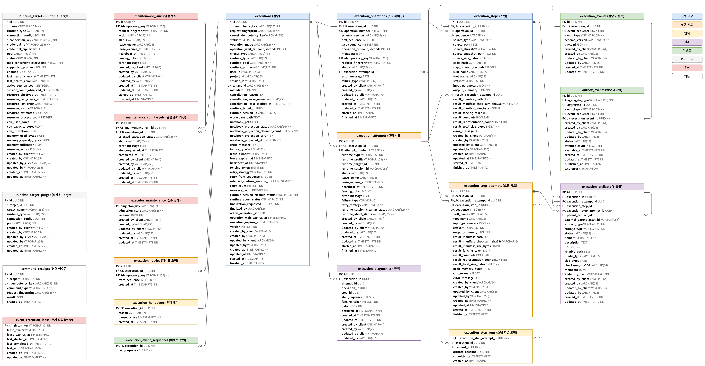

# 물리 ERD

| 항목 | 내용 |
|---|---|
| 시스템 | Executor (코드 실행 서비스) |
| 산출물 | 5. 물리 ERD |
| 버전 | 1.1 |
| 작성일 | 2026-11-25 |
| 기준 | 저장소 `kimhwajin/executor` `main` `3a43a90`, 스키마 리비전 `0017` |

| 버전 | 일자 | 내용 |
|---|---|---|
| 1.0 | 2026-11-25 | 최초 작성 |
| 1.1 | 2026-11-27 | 그림에 감사 컬럼을 포함한 모든 컬럼을 표시 |

PostgreSQL에 만들어지는 20개 테이블과 그 사이의 외래 키를 보여준다. 그림은 ORM 모델에서 자동 생성하므로 스키마와 어긋나지 않는다(`scripts/deliverables/schema.py`). 그림 원본은 `diagrams/05-물리-ERD.drawio`이고, 컬럼별 정의는 Table 정의서에 있다.

## 1. 물리 ERD

그림이 크므로 세부는 `diagrams/05-물리-ERD.drawio`를 Draw.io에서 열어 확대해 본다.

### 1.1 표기

| 표기 | 뜻 |
|---|---|
| PK, FK, UK | 기본 키, 외래 키, UNIQUE 제약에 든 컬럼 |
| NN | NOT NULL |
| 색 | 업무 영역(논리 ERD와 같은 색) |
| 테이블 위를 지나는 선 | 두 칸 이상 떨어진 테이블 사이의 외래 키 |

## 2. 설계 원칙

- **상태값은 문자열 + CHECK 제약.** PostgreSQL enum 타입을 쓰지 않아 값 추가가 마이그레이션 한 줄이다. 허용값의 원본은 `domain/enums.py`.
- **Runtime Target에는 FK를 걸지 않는다.** `runtime_target_id`는 일반 UUID 컬럼이고, 삭제된 Target은 `runtime_target_purges`에서 해석한다.
- **이력은 지우지 않고 쌓는다.** `execution_attempts`, `execution_step_attempts`는 불변이고 `execution_steps`는 현재 결과만 가리킨다.
- **조회 단축용 `execution_id`.** 하위 테이블 대부분이 `executions`를 직접 참조해, 실행 단위 조회와 `ON DELETE CASCADE`가 한 번에 된다.

## 3. 삭제 규칙

`executions`를 지우면 실행 계열 테이블 대부분이 `ON DELETE CASCADE`로 함께 지워진다. 예외는 다음과 같다.

| 외래 키 | 규칙 | 뜻 |
|---|---|---|
| `outbox_events.execution_event_id` → `execution_events` | RESTRICT | 이벤트를 지우려면 Outbox 행을 먼저 지워야 한다. 보존 작업이 이 순서로 지운다 |
| `maintenance_run_targets.execution_id` → `executions` | NO ACTION | 일괄 중지 대상이었던 실행은 그 Run 행을 먼저 지워야 한다 |
| `execution_operations.execution_attempt_id` → `execution_attempts` | NO ACTION | Execution을 통째로 지울 때는 CASCADE로 함께 지워진다 |

## 4. 주요 인덱스

| 인덱스 | 쓰는 곳 |
|---|---|
| `ix_executions_status_created_at` | Worker가 대기 실행을 순서대로 찾기, 상태별 목록 |
| `ix_executions_lease`, `ix_executions_cancellation_lease` | 만료 lease 회수, 취소 대상 찾기 |
| `ix_executions_{tenant,user,project,session}_created_cursor`, `ix_executions_created_cursor` | 목록 API 필터와 커서 페이지 |
| `ix_executions_execution_expires_at`, `ix_executions_operation_wait_expires_at` | 수명·대기 초과 감시 |
| `ix_executions_retained_session_cleanup` | 보존 세션 만료 정리 |
| `ix_execution_attempts_target_status` | Target별 사용 슬롯과 메모리 예약 계산(claim마다 실행) |
| `ix_outbox_pending`, `ix_outbox_pending_event_order`(부분 인덱스) | Outbox 발행 대상과 선행 PENDING 확인 |
| `ix_execution_events_execution_cursor`, `ix_execution_events_created` | 실행별 이벤트 조회, 보존 정리 |
| `ix_runtime_targets_pool_status` | Target 후보 조회 |

전체 인덱스와 제약은 Table 정의서의 테이블별 시트에 있다.

## 5. 잠금 지점

| 잠금 | 어디서 | 영향 |
|---|---|---|
| `executions` 행 `FOR UPDATE SKIP LOCKED` | claim, 취소 claim, lease 회수 | 다른 Worker가 잡은 행은 건너뛰므로 대기가 없다 |
| `runtime_targets` 행 `FOR UPDATE` | claim에서 고른 Target 하나 | 같은 Target으로 가는 claim이 순서대로 처리된다 |
| `executor_maintenance` 행 `FOR SHARE` | 새 claim마다 | drain 요청(`FOR UPDATE`)이 진행 중 claim이 끝나기를 기다린다 |
| `outbox_events` 행 `FOR UPDATE SKIP LOCKED` | Outbox 발행 | Redis 응답을 기다리는 동안 트랜잭션이 열려 있다 |
| advisory lock | 기동 마이그레이션 | 다른 Pod는 최대 `DB_MIGRATION_LOCK_TIMEOUT_SECONDS` 대기 |

## 6. 마이그레이션

Alembic 리비전 `0001`~`0017`. 기동 시 `DB_AUTO_MIGRATE=true`면 Pod가 직접 upgrade한다. 앱은 `alembic_version`이 `0017` 이상이면 ready다. 컬럼 삭제·이름 변경은 코드가 그 컬럼을 쓰지 않게 된 다음 릴리스에서 한다(확장 후 축소). 롤링 업데이트 중 구·신 Pod가 같은 스키마를 쓰기 때문이다.

| 리비전 | 내용 |
|---|---|
| 0001 | 전체 스키마 기준점 |
| 0002 | 실행 진단(`execution_diagnostics`) |
| 0003 | 필수 결과 완료 판정 |
| 0004 | trace context 제거 |
| 0005 | Runtime Target 삭제 이력(`runtime_target_purges`) |
| 0006 | Step 실행 저널과 인계(`execution_step_runs`, `execution_handovers`) |
| 0007 | 테넌트 컬럼 |
| 0008 | Target 물리 서버 키(`connection_key`) |
| 0009 | 취소 heartbeat 컬럼 제거 |
| 0010 | Outbox를 실행 이벤트 전용으로 |
| 0011 | 미사용 task/workflow 컬럼 제거 |
| 0012 | 테넌트 필수화 |
| 0013 | `finalized_by` |
| 0014 | 멱등 키 범위를 테넌트·Execution 단위로 |
| 0015 | 감사 컬럼을 호출 클라이언트 기준으로 |
| 0016 | 이벤트의 `runtime.session_id`를 `kernel_id`로 |
| 0017 | Step 시도의 커널 최대 메모리와 CPU 시간(`peak_memory_bytes`, `cpu_seconds`) |
