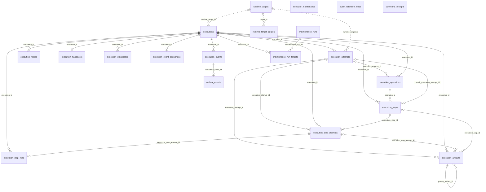

# 물리 ERD

| 항목 | 내용 |
|---|---|
| 시스템 | Executor (코드 실행 서비스) |
| 산출물 | 5. 물리 ERD |
| 버전 | 1.2 |
| 작성일 | 2026-11-25 |
| 기준 | 저장소 `kimhwajin/executor` `main` `3a43a90`, 스키마 리비전 `0017` |

| 버전 | 일자 | 내용 |
|---|---|---|
| 1.0 | 2026-11-25 | 최초 작성 |
| 1.1 | 2026-11-27 | 그림에 감사 컬럼을 포함한 모든 컬럼을 표시 |
| 1.2 | 2026-11-27 | Markdown에 텍스트 ERD(7장) 추가, 삭제 규칙에 SET NULL 추가 |

PostgreSQL에 만들어지는 20개 테이블과 그 사이의 외래 키를 보여준다. 그림은 ORM 모델에서 자동 생성하므로 스키마와 어긋나지 않는다(`scripts/deliverables/schema.py`). 그림 원본은 `diagrams/05-물리-ERD.drawio`이고, 컬럼별 정의는 Table 정의서에 있다.

## 1. 물리 ERD

그림이 크므로 세부는 `diagrams/05-물리-ERD.drawio`를 Draw.io에서 열어 확대해 본다.

### 1.1 표기

| 표기 | 뜻 |
|---|---|
| PK, FK, UK | 기본 키, 외래 키, UNIQUE 제약에 든 컬럼 |
| NN | NOT NULL |
| 색 | 업무 영역(논리 ERD와 같은 색) |
| 테이블 위를 지나는 선 | 두 칸 이상 떨어진 테이블 사이의 외래 키 |

## 2. 설계 원칙

- **상태값은 문자열 + CHECK 제약.** PostgreSQL enum 타입을 쓰지 않아 값 추가가 마이그레이션 한 줄이다. 허용값의 원본은 `domain/enums.py`.
- **Runtime Target에는 FK를 걸지 않는다.** `runtime_target_id`는 일반 UUID 컬럼이고, 삭제된 Target은 `runtime_target_purges`에서 해석한다.
- **이력은 지우지 않고 쌓는다.** `execution_attempts`, `execution_step_attempts`는 불변이고 `execution_steps`는 현재 결과만 가리킨다.
- **조회 단축용 `execution_id`.** 하위 테이블 대부분이 `executions`를 직접 참조해, 실행 단위 조회와 `ON DELETE CASCADE`가 한 번에 된다.

## 3. 삭제 규칙

`executions`를 지우면 실행 계열 테이블 대부분이 `ON DELETE CASCADE`로 함께 지워진다. 예외는 다음과 같다.

| 외래 키 | 규칙 | 뜻 |
|---|---|---|
| `outbox_events.execution_event_id` → `execution_events` | RESTRICT | 이벤트를 지우려면 Outbox 행을 먼저 지워야 한다. 보존 작업이 이 순서로 지운다 |
| `maintenance_run_targets.execution_id` → `executions` | NO ACTION | 일괄 중지 대상이었던 실행은 그 Run 행을 먼저 지워야 한다 |
| `execution_operations.execution_attempt_id` → `execution_attempts` | NO ACTION | Execution을 통째로 지울 때는 CASCADE로 함께 지워진다 |
| `execution_steps.result_execution_attempt_id` → `execution_attempts`, `execution_artifacts`의 `execution_step_attempt_id`, `execution_step_id`, `parent_artifact_id` | SET NULL | 가리키던 행이 지워지면 참조만 비우고 행은 남긴다 |

## 4. 주요 인덱스

| 인덱스 | 쓰는 곳 |
|---|---|
| `ix_executions_status_created_at` | Worker가 대기 실행을 순서대로 찾기, 상태별 목록 |
| `ix_executions_lease`, `ix_executions_cancellation_lease` | 만료 lease 회수, 취소 대상 찾기 |
| `ix_executions_{tenant,user,project,session}_created_cursor`, `ix_executions_created_cursor` | 목록 API 필터와 커서 페이지 |
| `ix_executions_execution_expires_at`, `ix_executions_operation_wait_expires_at` | 수명·대기 초과 감시 |
| `ix_executions_retained_session_cleanup` | 보존 세션 만료 정리 |
| `ix_execution_attempts_target_status` | Target별 사용 슬롯과 메모리 예약 계산(claim마다 실행) |
| `ix_outbox_pending`, `ix_outbox_pending_event_order`(부분 인덱스) | Outbox 발행 대상과 선행 PENDING 확인 |
| `ix_execution_events_execution_cursor`, `ix_execution_events_created` | 실행별 이벤트 조회, 보존 정리 |
| `ix_runtime_targets_pool_status` | Target 후보 조회 |

전체 인덱스와 제약은 Table 정의서의 테이블별 시트에 있다.

## 5. 잠금 지점

| 잠금 | 어디서 | 영향 |
|---|---|---|
| `executions` 행 `FOR UPDATE SKIP LOCKED` | claim, 취소 claim, lease 회수 | 다른 Worker가 잡은 행은 건너뛰므로 대기가 없다 |
| `runtime_targets` 행 `FOR UPDATE` | claim에서 고른 Target 하나 | 같은 Target으로 가는 claim이 순서대로 처리된다 |
| `executor_maintenance` 행 `FOR SHARE` | 새 claim마다 | drain 요청(`FOR UPDATE`)이 진행 중 claim이 끝나기를 기다린다 |
| `outbox_events` 행 `FOR UPDATE SKIP LOCKED` | Outbox 발행 | Redis 응답을 기다리는 동안 트랜잭션이 열려 있다 |
| advisory lock | 기동 마이그레이션 | 다른 Pod는 최대 `DB_MIGRATION_LOCK_TIMEOUT_SECONDS` 대기 |

## 6. 마이그레이션

Alembic 리비전 `0001`~`0017`. 기동 시 `DB_AUTO_MIGRATE=true`면 Pod가 직접 upgrade한다. 앱은 `alembic_version`이 `0017` 이상이면 ready다. 컬럼 삭제·이름 변경은 코드가 그 컬럼을 쓰지 않게 된 다음 릴리스에서 한다(확장 후 축소). 롤링 업데이트 중 구·신 Pod가 같은 스키마를 쓰기 때문이다.

| 리비전 | 내용 |
|---|---|
| 0001 | 전체 스키마 기준점 |
| 0002 | 실행 진단(`execution_diagnostics`) |
| 0003 | 필수 결과 완료 판정 |
| 0004 | trace context 제거 |
| 0005 | Runtime Target 삭제 이력(`runtime_target_purges`) |
| 0006 | Step 실행 저널과 인계(`execution_step_runs`, `execution_handovers`) |
| 0007 | 테넌트 컬럼 |
| 0008 | Target 물리 서버 키(`connection_key`) |
| 0009 | 취소 heartbeat 컬럼 제거 |
| 0010 | Outbox를 실행 이벤트 전용으로 |
| 0011 | 미사용 task/workflow 컬럼 제거 |
| 0012 | 테넌트 필수화 |
| 0013 | `finalized_by` |
| 0014 | 멱등 키 범위를 테넌트·Execution 단위로 |
| 0015 | 감사 컬럼을 호출 클라이언트 기준으로 |
| 0016 | 이벤트의 `runtime.session_id`를 `kernel_id`로 |
| 0017 | Step 시도의 커널 최대 메모리와 CPU 시간(`peak_memory_bytes`, `cpu_seconds`) |

<!-- md-only:start -->

<!-- 여기부터 md-only:end까지는 scripts/deliverables/schema.py가 만든다. 손으로 고치지 않는다. Word 제출본에는 넣지 않는다. -->

## 7. 텍스트 ERD

그림과 같은 내용을 글로 적은 것이다. 테이블 20개, 컬럼 351개, 외래 키 24개를 모두 담았다. Mermaid를 그려 주는 화면(GitHub 등)에서는 7.1과 7.2가 그림으로 보인다.

### 7.1 관계 개요

실선은 외래 키, 점선은 외래 키 없이 값으로만 가리키는 참조다. 선 위의 글자는 자식 테이블의 컬럼이다.

### 7.2 전체 ERD (컬럼 포함)

`PK` 기본 키, `FK` 외래 키, `UK` UNIQUE 제약에 든 컬럼, `NN` NOT NULL.

```mermaid
erDiagram
    executions {
        UUID id PK "NN"
        VARCHAR(255) idempotency_key UK "NN"
        VARCHAR(64) request_fingerprint "NN"
        VARCHAR(255) cancel_idempotency_key
        VARCHAR(32) status "NN"
        VARCHAR(32) operation_mode "NN"
        INTEGER operation_wait_timeout_seconds
        VARCHAR(32) trigger_type "NN"
        VARCHAR(32) runtime_type "NN"
        VARCHAR(32) runtime_pool "NN"
        VARCHAR(128) runtime_profile "NN"
        VARCHAR(255) user_id "NN"
        VARCHAR(255) project_id
        VARCHAR(255) session_id
        VARCHAR(64) tenant_id UK "NN"
        JSON metadata "NN"
        TEXT cancellation_reason
        VARCHAR(255) cancellation_lease_owner
        TIMESTAMPTZ cancellation_lease_expires_at
        UUID runtime_target_id
        VARCHAR(255) runtime_session_id
        TEXT workspace_path
        TEXT notebook_path
        VARCHAR(16) notebook_projection_status "NN"
        INTEGER notebook_projection_attempt_count "NN"
        TEXT notebook_projection_error
        TIMESTAMPTZ notebook_projected_at
        TEXT error_message
        VARCHAR(32) failure_type
        VARCHAR(255) lease_owner
        TIMESTAMPTZ lease_expires_at
        TIMESTAMPTZ heartbeat_at
        BIGINT fencing_token "NN"
        VARCHAR(32) retry_strategy "NN"
        INTEGER retry_from_sequence
        TIMESTAMPTZ retained_runtime_session_until
        INTEGER retry_count "NN"
        INTEGER recovery_count "NN"
        VARCHAR(32) runtime_session_cleanup_status "NN"
        VARCHAR(32) runtime_abort_status "NN"
        BOOLEAN finalization_requested "NN"
        VARCHAR(32) finalized_by
        UUID active_operation_id
        TIMESTAMPTZ operation_wait_expires_at
        TIMESTAMPTZ execution_expires_at
        INTEGER version "NN"
        VARCHAR(64) created_by_client
        VARCHAR(255) created_by
        VARCHAR(64) updated_by_client
        VARCHAR(255) updated_by
        TIMESTAMPTZ created_at "NN"
        TIMESTAMPTZ updated_at "NN"
        TIMESTAMPTZ started_at
        TIMESTAMPTZ finished_at
    }
    execution_operations {
        UUID id PK "NN"
        UUID execution_id FK,UK "NN"
        INTEGER operation_number UK "NN"
        VARCHAR(16) schema_version "NN"
        INTEGER first_sequence "NN"
        INTEGER last_sequence "NN"
        INTEGER operation_timeout_seconds
        JSON metadata "NN"
        VARCHAR(255) idempotency_key UK "NN"
        VARCHAR(64) request_fingerprint "NN"
        VARCHAR(32) status "NN"
        UUID execution_attempt_id FK
        TEXT error_message
        VARCHAR(32) failure_type
        VARCHAR(64) created_by_client
        VARCHAR(255) created_by
        VARCHAR(64) updated_by_client
        VARCHAR(255) updated_by
        TIMESTAMPTZ created_at "NN"
        TIMESTAMPTZ updated_at "NN"
        TIMESTAMPTZ started_at
        TIMESTAMPTZ finished_at
    }
    execution_steps {
        UUID id PK "NN"
        UUID execution_id FK,UK "NN"
        UUID operation_id FK "NN"
        INTEGER sequence UK "NN"
        VARCHAR(32) source_type "NN"
        TEXT source_path
        VARCHAR(64) source_sha256 "NN"
        TEXT source_snapshot_path "NN"
        BIGINT source_size_bytes "NN"
        VARCHAR(64) code_hash
        INTEGER step_timeout_seconds
        VARCHAR(255) skill_name
        VARCHAR(255) tool_name
        VARCHAR(32) status "NN"
        JSON input_parameters "NN"
        JSON output_summary "NN"
        UUID result_execution_attempt_id FK
        TEXT result_manifest_path
        VARCHAR(64) result_manifest_checksum_sha256
        BIGINT result_manifest_size_bytes
        BIGINT result_fencing_token
        BOOLEAN result_complete
        BIGINT result_representation_count "NN"
        BIGINT result_total_size_bytes "NN"
        TEXT error_message
        VARCHAR(64) created_by_client
        VARCHAR(255) created_by
        VARCHAR(64) updated_by_client
        VARCHAR(255) updated_by
        TIMESTAMPTZ created_at "NN"
        TIMESTAMPTZ updated_at "NN"
        TIMESTAMPTZ started_at
        TIMESTAMPTZ finished_at
    }
    execution_attempts {
        UUID id PK "NN"
        UUID execution_id FK,UK "NN"
        INTEGER attempt_number UK "NN"
        VARCHAR(32) runtime_type "NN"
        VARCHAR(128) runtime_profile "NN"
        UUID runtime_target_id "NN"
        VARCHAR(255) runtime_session_id
        VARCHAR(32) status "NN"
        VARCHAR(255) lease_owner
        TIMESTAMPTZ lease_expires_at
        TIMESTAMPTZ heartbeat_at "NN"
        BIGINT fencing_token "NN"
        TEXT error_message
        VARCHAR(32) failure_type
        VARCHAR(32) retry_strategy "NN"
        VARCHAR(32) runtime_session_cleanup_status "NN"
        VARCHAR(32) runtime_abort_status "NN"
        VARCHAR(64) created_by_client
        VARCHAR(255) created_by
        VARCHAR(64) updated_by_client
        VARCHAR(255) updated_by
        TIMESTAMPTZ created_at "NN"
        TIMESTAMPTZ updated_at "NN"
        TIMESTAMPTZ started_at "NN"
        TIMESTAMPTZ finished_at
    }
    execution_step_attempts {
        UUID id PK "NN"
        UUID execution_id FK "NN"
        UUID execution_attempt_id FK,UK "NN"
        UUID execution_step_id FK "NN"
        INTEGER sequence UK "NN"
        VARCHAR(255) skill_name
        VARCHAR(255) tool_name
        JSON input_parameters "NN"
        VARCHAR(32) status "NN"
        JSON output_summary "NN"
        TEXT result_manifest_path
        VARCHAR(64) result_manifest_checksum_sha256
        BIGINT result_manifest_size_bytes
        BIGINT result_fencing_token
        BOOLEAN result_complete
        BIGINT result_representation_count "NN"
        BIGINT result_total_size_bytes "NN"
        BIGINT peak_memory_bytes
        FLOAT cpu_seconds
        TEXT error_message
        VARCHAR(64) created_by_client
        VARCHAR(255) created_by
        VARCHAR(64) updated_by_client
        VARCHAR(255) updated_by
        TIMESTAMPTZ created_at "NN"
        TIMESTAMPTZ updated_at "NN"
        TIMESTAMPTZ started_at "NN"
        TIMESTAMPTZ finished_at
    }
    execution_retries {
        UUID id PK "NN"
        UUID execution_id FK,UK "NN"
        VARCHAR(255) idempotency_key UK "NN"
        INTEGER from_sequence "NN"
        TIMESTAMPTZ created_at "NN"
    }
    execution_step_runs {
        UUID execution_step_attempt_id PK,FK "NN"
        UUID execution_id FK "NN"
        UUID request_id UK "NN"
        JSON artifact_baseline "NN"
        TIMESTAMPTZ submitted_at
        TIMESTAMPTZ created_at "NN"
    }
    execution_handovers {
        UUID execution_id PK,FK "NN"
        VARCHAR(32) reason "NN"
        TIMESTAMPTZ paused_since "NN"
        TIMESTAMPTZ created_at "NN"
    }
    execution_artifacts {
        UUID id PK "NN"
        UUID execution_id FK "NN"
        UUID execution_attempt_id FK
        UUID execution_step_id FK
        UUID execution_step_attempt_id FK
        UUID parent_artifact_id FK
        VARCHAR(255) external_parent_asset_id
        VARCHAR(32) artifact_type "NN"
        VARCHAR(32) storage_type "NN"
        VARCHAR(32) status "NN"
        VARCHAR(255) name "NN"
        TEXT description
        TEXT uri "NN"
        TEXT relative_path
        VARCHAR(255) media_type
        BIGINT size_bytes
        VARCHAR(64) checksum_sha256
        JSON metadata "NN"
        VARCHAR(64) identity_hash UK "NN"
        VARCHAR(64) created_by_client
        VARCHAR(255) created_by
        VARCHAR(64) updated_by_client
        VARCHAR(255) updated_by
        TIMESTAMPTZ created_at "NN"
        TIMESTAMPTZ updated_at "NN"
    }
    execution_diagnostics {
        UUID id PK "NN"
        UUID execution_id FK "NN"
        UUID attempt_id
        UUID operation_id
        UUID step_id
        INTEGER step_sequence
        INTEGER fencing_token "NN"
        JSON detail "NN"
        TIMESTAMPTZ occurred_at "NN"
        TIMESTAMPTZ created_at "NN"
        TIMESTAMPTZ updated_at "NN"
        VARCHAR(64) created_by_client
        VARCHAR(255) created_by
        VARCHAR(64) updated_by_client
        VARCHAR(255) updated_by
    }
    execution_event_sequences {
        UUID execution_id PK,FK "NN"
        BIGINT last_sequence "NN"
    }
    execution_events {
        UUID id PK "NN"
        UUID execution_id FK,UK "NN"
        BIGINT event_sequence UK "NN"
        VARCHAR(255) event_type "NN"
        VARCHAR(32) schema_version "NN"
        JSON payload "NN"
        VARCHAR(64) created_by_client
        VARCHAR(255) created_by
        VARCHAR(64) updated_by_client
        VARCHAR(255) updated_by
        TIMESTAMPTZ created_at "NN"
        TIMESTAMPTZ updated_at "NN"
    }
    outbox_events {
        UUID id PK "NN"
        VARCHAR(128) aggregate_type UK "NN"
        UUID aggregate_id UK "NN"
        VARCHAR(255) event_type "NN"
        BIGINT event_sequence UK "NN"
        UUID execution_event_id FK,UK "NN"
        VARCHAR(64) created_by_client
        VARCHAR(255) created_by
        VARCHAR(64) updated_by_client
        VARCHAR(255) updated_by
        VARCHAR(32) status "NN"
        INTEGER attempt_count "NN"
        TIMESTAMPTZ available_at "NN"
        TIMESTAMPTZ created_at "NN"
        TIMESTAMPTZ updated_at "NN"
        TIMESTAMPTZ published_at
        VARCHAR(500) last_error
    }
    runtime_targets {
        UUID id PK "NN"
        VARCHAR(255) name UK "NN"
        VARCHAR(32) runtime_type "NN"
        JSON connection_config "NN"
        VARCHAR(2048) connection_key UK "NN"
        VARCHAR(255) credential_ref "NN"
        TEXT credential_ciphertext
        VARCHAR(32) pool "NN"
        VARCHAR(32) status "NN"
        INTEGER max_concurrent_executions "NN"
        JSON supported_profiles "NN"
        BOOLEAN enabled "NN"
        TIMESTAMPTZ last_health_check_at
        VARCHAR(500) last_health_error
        INTEGER active_session_count
        TIMESTAMPTZ session_count_observed_at
        TIMESTAMPTZ resource_observed_at
        TIMESTAMPTZ resource_last_check_at
        VARCHAR(500) resource_last_error
        VARCHAR(64) resource_source
        BOOLEAN resource_estimated
        INTEGER resource_process_count
        FLOAT cpu_used_cores
        FLOAT cpu_capacity_cores
        FLOAT cpu_utilization
        BIGINT memory_used_bytes
        BIGINT memory_capacity_bytes
        FLOAT memory_utilization
        JSON resource_errors "NN"
        VARCHAR(64) created_by_client
        VARCHAR(255) created_by
        VARCHAR(64) updated_by_client
        VARCHAR(255) updated_by
        TIMESTAMPTZ created_at "NN"
        TIMESTAMPTZ updated_at "NN"
    }
    runtime_target_purges {
        UUID id PK "NN"
        UUID target_id UK "NN"
        VARCHAR(255) target_name "NN"
        VARCHAR(32) runtime_type "NN"
        JSON connection_config "NN"
        VARCHAR(32) pool "NN"
        VARCHAR(64) created_by_client
        VARCHAR(255) created_by
        VARCHAR(64) updated_by_client
        VARCHAR(255) updated_by
        TIMESTAMPTZ created_at "NN"
        TIMESTAMPTZ updated_at "NN"
    }
    executor_maintenance {
        VARCHAR(32) singleton_key PK "NN"
        VARCHAR(32) admission_state "NN"
        BIGINT version "NN"
        VARCHAR(64) created_by_client
        VARCHAR(255) created_by
        VARCHAR(64) updated_by_client
        VARCHAR(255) updated_by
        TIMESTAMPTZ created_at "NN"
        TIMESTAMPTZ updated_at "NN"
    }
    maintenance_runs {
        UUID id PK "NN"
        VARCHAR(255) idempotency_key UK "NN"
        VARCHAR(64) request_fingerprint "NN"
        VARCHAR(32) action "NN"
        VARCHAR(32) status "NN"
        VARCHAR(255) lease_owner
        TIMESTAMPTZ lease_expires_at
        TIMESTAMPTZ heartbeat_at
        BIGINT fencing_token "NN"
        TEXT error_message
        VARCHAR(64) created_by_client
        VARCHAR(255) created_by
        VARCHAR(64) updated_by_client
        VARCHAR(255) updated_by
        TIMESTAMPTZ created_at "NN"
        TIMESTAMPTZ updated_at "NN"
        TIMESTAMPTZ started_at
        TIMESTAMPTZ finished_at
    }
    maintenance_run_targets {
        UUID id PK "NN"
        UUID maintenance_run_id FK,UK "NN"
        UUID execution_id FK,UK "NN"
        VARCHAR(32) selected_execution_status "NN"
        VARCHAR(32) status "NN"
        TEXT error_message
        TIMESTAMPTZ stop_requested_at
        TIMESTAMPTZ completed_at
        VARCHAR(64) created_by_client
        VARCHAR(255) created_by
        VARCHAR(64) updated_by_client
        VARCHAR(255) updated_by
        TIMESTAMPTZ created_at "NN"
        TIMESTAMPTZ updated_at "NN"
    }
    event_retention_lease {
        VARCHAR(32) singleton_key PK "NN"
        VARCHAR(255) lease_owner
        TIMESTAMPTZ lease_expires_at
        TIMESTAMPTZ last_started_at
        TIMESTAMPTZ last_completed_at
        VARCHAR(1000) last_error
        TIMESTAMPTZ created_at "NN"
        TIMESTAMPTZ updated_at "NN"
    }
    command_receipts {
        UUID id PK "NN"
        VARCHAR(64) scope UK "NN"
        VARCHAR(255) idempotency_key UK "NN"
        VARCHAR(128) command_type "NN"
        VARCHAR(64) request_fingerprint "NN"
        JSON result "NN"
        TIMESTAMPTZ created_at "NN"
    }
    execution_attempts |o--o{ execution_operations : execution_attempt_id
    executions ||--o{ execution_operations : execution_id
    executions ||--o{ execution_steps : execution_id
    execution_operations ||--o{ execution_steps : operation_id
    execution_attempts |o--o{ execution_steps : result_execution_attempt_id
    executions ||--o{ execution_attempts : execution_id
    execution_attempts ||--o{ execution_step_attempts : execution_attempt_id
    executions ||--o{ execution_step_attempts : execution_id
    execution_steps ||--o{ execution_step_attempts : execution_step_id
    executions ||--o{ execution_retries : execution_id
    executions ||--o{ execution_step_runs : execution_id
    execution_step_attempts ||--o| execution_step_runs : execution_step_attempt_id
    executions ||--o| execution_handovers : execution_id
    execution_attempts |o--o{ execution_artifacts : execution_attempt_id
    executions ||--o{ execution_artifacts : execution_id
    execution_step_attempts |o--o{ execution_artifacts : execution_step_attempt_id
    execution_steps |o--o{ execution_artifacts : execution_step_id
    execution_artifacts |o--o{ execution_artifacts : parent_artifact_id
    executions ||--o{ execution_diagnostics : execution_id
    executions ||--o| execution_event_sequences : execution_id
    executions ||--o{ execution_events : execution_id
    execution_events ||--o| outbox_events : execution_event_id
    executions ||--o{ maintenance_run_targets : execution_id
    maintenance_runs ||--o{ maintenance_run_targets : maintenance_run_id
    runtime_targets |o..o{ executions : runtime_target_id
    runtime_targets |o..o{ execution_attempts : runtime_target_id
    runtime_targets |o..o{ runtime_target_purges : target_id
```

### 7.3 외래 키

| No | 자식 테이블.컬럼 | 부모 테이블.컬럼 | 부모 : 자식 | NULL | ON DELETE | 제약 이름 |
|---|---|---|---|---|---|---|
| 1 | `execution_operations.execution_attempt_id` | `execution_attempts.id` | 0..1 : 0..N | Y | NO ACTION | `fk_execution_operations_execution_attempt_id_execution_attempts` |
| 2 | `execution_operations.execution_id` | `executions.id` | 1 : 0..N | N | CASCADE | `fk_execution_operations_execution_id_executions` |
| 3 | `execution_steps.execution_id` | `executions.id` | 1 : 0..N | N | CASCADE | `fk_execution_steps_execution_id_executions` |
| 4 | `execution_steps.operation_id` | `execution_operations.id` | 1 : 0..N | N | CASCADE | `fk_execution_steps_operation_id_execution_operations` |
| 5 | `execution_steps.result_execution_attempt_id` | `execution_attempts.id` | 0..1 : 0..N | Y | SET NULL | `fk_execution_steps_result_execution_attempt_id_execution_attempts` |
| 6 | `execution_attempts.execution_id` | `executions.id` | 1 : 0..N | N | CASCADE | `fk_execution_attempts_execution_id_executions` |
| 7 | `execution_step_attempts.execution_attempt_id` | `execution_attempts.id` | 1 : 0..N | N | CASCADE | `fk_execution_step_attempts_execution_attempt_id_execution_attempts` |
| 8 | `execution_step_attempts.execution_id` | `executions.id` | 1 : 0..N | N | CASCADE | `fk_execution_step_attempts_execution_id_executions` |
| 9 | `execution_step_attempts.execution_step_id` | `execution_steps.id` | 1 : 0..N | N | CASCADE | `fk_execution_step_attempts_execution_step_id_execution_steps` |
| 10 | `execution_retries.execution_id` | `executions.id` | 1 : 0..N | N | CASCADE | `fk_execution_retries_execution_id_executions` |
| 11 | `execution_step_runs.execution_id` | `executions.id` | 1 : 0..N | N | CASCADE | `fk_execution_step_runs_execution_id_executions` |
| 12 | `execution_step_runs.execution_step_attempt_id` | `execution_step_attempts.id` | 1 : 0..1 | N | CASCADE | `fk_execution_step_runs_execution_step_attempt_id_execution_step_attempts` |
| 13 | `execution_handovers.execution_id` | `executions.id` | 1 : 0..1 | N | CASCADE | `fk_execution_handovers_execution_id_executions` |
| 14 | `execution_artifacts.execution_attempt_id` | `execution_attempts.id` | 0..1 : 0..N | Y | CASCADE | `fk_execution_artifacts_execution_attempt_id_execution_attempts` |
| 15 | `execution_artifacts.execution_id` | `executions.id` | 1 : 0..N | N | CASCADE | `fk_execution_artifacts_execution_id_executions` |
| 16 | `execution_artifacts.execution_step_attempt_id` | `execution_step_attempts.id` | 0..1 : 0..N | Y | SET NULL | `fk_execution_artifacts_execution_step_attempt_id_execution_step_attempts` |
| 17 | `execution_artifacts.execution_step_id` | `execution_steps.id` | 0..1 : 0..N | Y | SET NULL | `fk_execution_artifacts_execution_step_id_execution_steps` |
| 18 | `execution_artifacts.parent_artifact_id` | `execution_artifacts.id` | 0..1 : 0..N | Y | SET NULL | `fk_execution_artifacts_parent_artifact_id_execution_artifacts` |
| 19 | `execution_diagnostics.execution_id` | `executions.id` | 1 : 0..N | N | CASCADE | `fk_execution_diagnostics_execution_id_executions` |
| 20 | `execution_event_sequences.execution_id` | `executions.id` | 1 : 0..1 | N | CASCADE | `fk_execution_event_sequences_execution_id_executions` |
| 21 | `execution_events.execution_id` | `executions.id` | 1 : 0..N | N | CASCADE | `fk_execution_events_execution_id_executions` |
| 22 | `outbox_events.execution_event_id` | `execution_events.id` | 1 : 0..1 | N | RESTRICT | `fk_outbox_events_execution_event_id_execution_events` |
| 23 | `maintenance_run_targets.execution_id` | `executions.id` | 1 : 0..N | N | NO ACTION | `fk_maintenance_run_targets_execution_id_executions` |
| 24 | `maintenance_run_targets.maintenance_run_id` | `maintenance_runs.id` | 1 : 0..N | N | CASCADE | `fk_maintenance_run_targets_maintenance_run_id_maintenance_runs` |

외래 키 없이 값으로만 가리키는 참조는 다음과 같다.

| No | 테이블.컬럼 | 가리키는 곳 | 외래 키를 걸지 않은 이유 |
|---|---|---|---|
| 1 | `executions.runtime_target_id` | `runtime_targets.id` | Target을 지워도 실행 이력이 남아야 한다 |
| 2 | `execution_attempts.runtime_target_id` | `runtime_targets.id` | Target을 지워도 시도 이력이 남아야 한다 |
| 3 | `runtime_target_purges.target_id` | `runtime_targets.id` | 지워진 Target의 ID를 기억한다 |

### 7.4 테이블별 컬럼

#### 7.4.1 executions (실행)

실행 요청 영역. 호출자의 실행 요청 1건.

| No | 컬럼 | 타입 | NULL | 키 | 참조 | 설명 |
|---|---|---|---|---|---|---|
| 1 | `id` | UUID | N | PK |  | 식별자 |
| 2 | `idempotency_key` | VARCHAR(255) | N | UK |  | 제출 멱등 키. 테넌트 안에서 유일 |
| 3 | `request_fingerprint` | VARCHAR(64) | N |  |  | 요청 본문 지문(sha256). 같은 키로 다른 요청이 오면 충돌 |
| 4 | `cancel_idempotency_key` | VARCHAR(255) | Y |  |  | 취소 요청 멱등 키 |
| 5 | `status` | VARCHAR(32) | N |  |  | Execution 상태 |
| 6 | `operation_mode` | VARCHAR(32) | N |  |  | SINGLE / MULTI |
| 7 | `operation_wait_timeout_seconds` | INTEGER | Y |  |  | MULTI가 다음 Operation을 기다리는 최대 초(30 이상) |
| 8 | `trigger_type` | VARCHAR(32) | N |  |  | INTERACTIVE / BATCH. 풀 선택에 쓰인다 |
| 9 | `runtime_type` | VARCHAR(32) | N |  |  | Runtime 종류(JUPYTER) |
| 10 | `runtime_pool` | VARCHAR(32) | N |  |  | 배정 풀. trigger_type과 같은 값 |
| 11 | `runtime_profile` | VARCHAR(128) | N |  |  | 커널 프로필(kernelspec). RUNTIME_ALLOWED_PROFILES 중 하나 |
| 12 | `user_id` | VARCHAR(255) | N |  |  | 요청 사용자(X-User-Id) |
| 13 | `project_id` | VARCHAR(255) | Y |  |  | 요청 프로젝트(X-Project-Id) |
| 14 | `session_id` | VARCHAR(255) | Y |  |  | 호출자 대화 세션(X-Session-Id). 커널 세션과 무관 |
| 15 | `tenant_id` | VARCHAR(64) | N | UK |  | 테넌트. 이벤트 Stream과 작업공간 경로를 나눈다 |
| 16 | `metadata` | JSON | N |  |  | 호출자가 넣은 임의 JSON |
| 17 | `cancellation_reason` | TEXT | Y |  |  | 취소 사유 |
| 18 | `cancellation_lease_owner` | VARCHAR(255) | Y |  |  | 취소 처리 중인 Worker |
| 19 | `cancellation_lease_expires_at` | TIMESTAMPTZ | Y |  |  | 취소 lease 만료 시각 |
| 20 | `runtime_target_id` | UUID | Y |  | `runtime_targets.id` (FK 없음) | 배정된 Target. FK 없음(삭제된 Target은 runtime_target_purges로 해석) |
| 21 | `runtime_session_id` | VARCHAR(255) | Y |  |  | Jupyter 커널 세션 ID |
| 22 | `workspace_path` | TEXT | Y |  |  | Jupyter 작업공간 상대경로 |
| 23 | `notebook_path` | TEXT | Y |  |  | 실행 노트북 상대경로 |
| 24 | `notebook_projection_status` | VARCHAR(16) | N |  |  | 노트북 반영 상태 |
| 25 | `notebook_projection_attempt_count` | INTEGER | N |  |  | 노트북 반영 시도 횟수 |
| 26 | `notebook_projection_error` | TEXT | Y |  |  | 노트북 반영 오류 |
| 27 | `notebook_projected_at` | TIMESTAMPTZ | Y |  |  | 노트북 반영 시각 |
| 28 | `error_message` | TEXT | Y |  |  | 마지막 오류 요약 |
| 29 | `failure_type` | VARCHAR(32) | Y |  |  | 실패 원인 분류 |
| 30 | `lease_owner` | VARCHAR(255) | Y |  |  | 실행 소유 Worker ID |
| 31 | `lease_expires_at` | TIMESTAMPTZ | Y |  |  | 실행 lease 만료 시각 |
| 32 | `heartbeat_at` | TIMESTAMPTZ | Y |  |  | 마지막 lease 갱신 |
| 33 | `fencing_token` | BIGINT | N |  |  | 소유권 세대 번호. claim마다 +1 |
| 34 | `retry_strategy` | VARCHAR(32) | N |  |  | 가능한 재시도 방식 |
| 35 | `retry_from_sequence` | INTEGER | Y |  |  | FROM_FAILED_STEP 재시도 시작 Step |
| 36 | `retained_runtime_session_until` | TIMESTAMPTZ | Y |  |  | 재시도용 실패 세션 보존 기한 |
| 37 | `retry_count` | INTEGER | N |  |  | 재시도 횟수 |
| 38 | `recovery_count` | INTEGER | N |  |  | Worker 장애 회수 횟수 |
| 39 | `runtime_session_cleanup_status` | VARCHAR(32) | N |  |  | 커널 세션 정리 상태 |
| 40 | `runtime_abort_status` | VARCHAR(32) | N |  |  | 시간 초과 등으로 중단한 결과 |
| 41 | `finalization_requested` | BOOLEAN | N |  |  | MULTI finalize 요청 여부 |
| 42 | `finalized_by` | VARCHAR(32) | Y |  |  | 종료 주체(AGENT, WAIT_TIMEOUT, MAX_RUNTIME) |
| 43 | `active_operation_id` | UUID | Y |  |  | 지금 처리 중이거나 대기 중인 Operation |
| 44 | `operation_wait_expires_at` | TIMESTAMPTZ | Y |  |  | MULTI 다음 Operation 대기 기한 |
| 45 | `execution_expires_at` | TIMESTAMPTZ | Y |  |  | 최대 수명 기한(첫 시작 + 7일) |
| 46 | `version` | INTEGER | N |  |  | 낙관적 동시성 버전 |
| 47 | `created_by_client` | VARCHAR(64) | Y |  |  | 행을 만든 호출 클라이언트 |
| 48 | `created_by` | VARCHAR(255) | Y |  |  | 행을 만든 사용자 |
| 49 | `updated_by_client` | VARCHAR(64) | Y |  |  | 마지막으로 고친 호출 클라이언트 |
| 50 | `updated_by` | VARCHAR(255) | Y |  |  | 마지막으로 고친 사용자 |
| 51 | `created_at` | TIMESTAMPTZ | N |  |  | 생성 시각 |
| 52 | `updated_at` | TIMESTAMPTZ | N |  |  | 마지막 변경 시각 |
| 53 | `started_at` | TIMESTAMPTZ | Y |  |  | 첫 시작 |
| 54 | `finished_at` | TIMESTAMPTZ | Y |  |  | 종료 |

#### 7.4.2 execution_operations (오퍼레이션)

실행 요청 영역. 한 번에 제출된 Step 묶음.

| No | 컬럼 | 타입 | NULL | 키 | 참조 | 설명 |
|---|---|---|---|---|---|---|
| 1 | `id` | UUID | N | PK |  | 식별자 |
| 2 | `execution_id` | UUID | N | FK,UK | `executions.id` | 소속 Execution |
| 3 | `operation_number` | INTEGER | N | UK |  | Execution 안 순번(1부터) |
| 4 | `schema_version` | VARCHAR(16) | N |  |  | 요청 스펙 버전(1.0) |
| 5 | `first_sequence` | INTEGER | N |  |  | 첫 Step 순번 |
| 6 | `last_sequence` | INTEGER | N |  |  | 마지막 Step 순번 |
| 7 | `operation_timeout_seconds` | INTEGER | Y |  |  | Operation 시간 한도 |
| 8 | `metadata` | JSON | N |  |  | 호출자 JSON |
| 9 | `idempotency_key` | VARCHAR(255) | N | UK |  | Operation 멱등 키. Execution 안에서 유일 |
| 10 | `request_fingerprint` | VARCHAR(64) | N |  |  | 요청 지문 |
| 11 | `status` | VARCHAR(32) | N |  |  | Operation 상태 |
| 12 | `execution_attempt_id` | UUID | Y | FK | `execution_attempts.id` | 이 Operation을 실행한 Attempt |
| 13 | `error_message` | TEXT | Y |  |  | 오류 요약 |
| 14 | `failure_type` | VARCHAR(32) | Y |  |  | 실패 원인 |
| 15 | `created_by_client` | VARCHAR(64) | Y |  |  | 행을 만든 호출 클라이언트 |
| 16 | `created_by` | VARCHAR(255) | Y |  |  | 행을 만든 사용자 |
| 17 | `updated_by_client` | VARCHAR(64) | Y |  |  | 마지막으로 고친 호출 클라이언트 |
| 18 | `updated_by` | VARCHAR(255) | Y |  |  | 마지막으로 고친 사용자 |
| 19 | `created_at` | TIMESTAMPTZ | N |  |  | 생성 시각 |
| 20 | `updated_at` | TIMESTAMPTZ | N |  |  | 마지막 변경 시각 |
| 21 | `started_at` | TIMESTAMPTZ | Y |  |  | 시작 |
| 22 | `finished_at` | TIMESTAMPTZ | Y |  |  | 종료 |

#### 7.4.3 execution_steps (스텝)

실행 요청 영역. Step(노트북 셀 하나)의 현재 상태.

| No | 컬럼 | 타입 | NULL | 키 | 참조 | 설명 |
|---|---|---|---|---|---|---|
| 1 | `id` | UUID | N | PK |  | 식별자 |
| 2 | `execution_id` | UUID | N | FK,UK | `executions.id` | 소속 Execution |
| 3 | `operation_id` | UUID | N | FK | `execution_operations.id` | 소속 Operation |
| 4 | `sequence` | INTEGER | N | UK |  | Execution 전체에서의 순번(0부터) |
| 5 | `source_type` | VARCHAR(32) | N |  |  | INLINE / PATH |
| 6 | `source_path` | TEXT | Y |  |  | PATH일 때 공유 PV 상대경로 |
| 7 | `source_sha256` | VARCHAR(64) | N |  |  | 원본 코드 sha256 |
| 8 | `source_snapshot_path` | TEXT | N |  |  | Executor 스냅샷 상대경로 |
| 9 | `source_size_bytes` | BIGINT | N |  |  | 스냅샷 크기 |
| 10 | `code_hash` | VARCHAR(64) | Y |  |  | 코드 해시 |
| 11 | `step_timeout_seconds` | INTEGER | Y |  |  | Step 시간 한도 |
| 12 | `skill_name` | VARCHAR(255) | Y |  |  | 호출자 표시용 |
| 13 | `tool_name` | VARCHAR(255) | Y |  |  | 호출자 표시용 |
| 14 | `status` | VARCHAR(32) | N |  |  | 현재 Step 상태(최신 Attempt 기준) |
| 15 | `input_parameters` | JSON | N |  |  | 호출자 입력 JSON |
| 16 | `output_summary` | JSON | N |  |  | 출력 요약 JSON |
| 17 | `result_execution_attempt_id` | UUID | Y | FK | `execution_attempts.id` | 현재 결과를 만든 Attempt |
| 18 | `result_manifest_path` | TEXT | Y |  |  | 결과 manifest 상대경로 |
| 19 | `result_manifest_checksum_sha256` | VARCHAR(64) | Y |  |  | manifest sha256 |
| 20 | `result_manifest_size_bytes` | BIGINT | Y |  |  | manifest 크기 |
| 21 | `result_fencing_token` | BIGINT | Y |  |  | 결과를 쓴 fencing token |
| 22 | `result_complete` | BOOLEAN | Y |  |  | 출력이 빠짐없이 저장됐는지 |
| 23 | `result_representation_count` | BIGINT | N |  |  | 출력 파일 수 |
| 24 | `result_total_size_bytes` | BIGINT | N |  |  | 출력 총 크기 |
| 25 | `error_message` | TEXT | Y |  |  | 오류 요약 |
| 26 | `created_by_client` | VARCHAR(64) | Y |  |  | 행을 만든 호출 클라이언트 |
| 27 | `created_by` | VARCHAR(255) | Y |  |  | 행을 만든 사용자 |
| 28 | `updated_by_client` | VARCHAR(64) | Y |  |  | 마지막으로 고친 호출 클라이언트 |
| 29 | `updated_by` | VARCHAR(255) | Y |  |  | 마지막으로 고친 사용자 |
| 30 | `created_at` | TIMESTAMPTZ | N |  |  | 생성 시각 |
| 31 | `updated_at` | TIMESTAMPTZ | N |  |  | 마지막 변경 시각 |
| 32 | `started_at` | TIMESTAMPTZ | Y |  |  | 시작 |
| 33 | `finished_at` | TIMESTAMPTZ | Y |  |  | 종료 |

#### 7.4.4 execution_attempts (실행 시도)

실행 시도 영역. Worker의 claim 1회.

| No | 컬럼 | 타입 | NULL | 키 | 참조 | 설명 |
|---|---|---|---|---|---|---|
| 1 | `id` | UUID | N | PK |  | 식별자 |
| 2 | `execution_id` | UUID | N | FK,UK | `executions.id` | 소속 Execution |
| 3 | `attempt_number` | INTEGER | N | UK |  | Execution 안 순번(1부터) |
| 4 | `runtime_type` | VARCHAR(32) | N |  |  | Runtime 종류(JUPYTER) |
| 5 | `runtime_profile` | VARCHAR(128) | N |  |  | 커널 프로필 |
| 6 | `runtime_target_id` | UUID | N |  | `runtime_targets.id` (FK 없음) | 실행한 Target. FK 없음 |
| 7 | `runtime_session_id` | VARCHAR(255) | Y |  |  | 커널 세션 |
| 8 | `status` | VARCHAR(32) | N |  |  | Attempt 상태 |
| 9 | `lease_owner` | VARCHAR(255) | Y |  |  | 소유 Worker |
| 10 | `lease_expires_at` | TIMESTAMPTZ | Y |  |  | lease 만료 |
| 11 | `heartbeat_at` | TIMESTAMPTZ | N |  |  | 마지막 갱신 |
| 12 | `fencing_token` | BIGINT | N |  |  | 이 Attempt의 fencing token |
| 13 | `error_message` | TEXT | Y |  |  | 오류 요약 |
| 14 | `failure_type` | VARCHAR(32) | Y |  |  | 실패 원인 |
| 15 | `retry_strategy` | VARCHAR(32) | N |  |  | 재시도 방식 |
| 16 | `runtime_session_cleanup_status` | VARCHAR(32) | N |  |  | 세션 정리 상태 |
| 17 | `runtime_abort_status` | VARCHAR(32) | N |  |  | 중단 결과 |
| 18 | `created_by_client` | VARCHAR(64) | Y |  |  | 행을 만든 호출 클라이언트 |
| 19 | `created_by` | VARCHAR(255) | Y |  |  | 행을 만든 사용자 |
| 20 | `updated_by_client` | VARCHAR(64) | Y |  |  | 마지막으로 고친 호출 클라이언트 |
| 21 | `updated_by` | VARCHAR(255) | Y |  |  | 마지막으로 고친 사용자 |
| 22 | `created_at` | TIMESTAMPTZ | N |  |  | 생성 시각 |
| 23 | `updated_at` | TIMESTAMPTZ | N |  |  | 마지막 변경 시각 |
| 24 | `started_at` | TIMESTAMPTZ | N |  |  | 시작 |
| 25 | `finished_at` | TIMESTAMPTZ | Y |  |  | 종료 |

#### 7.4.5 execution_step_attempts (스텝 시도)

실행 시도 영역. Step 실행 시도 1회와 그 결과 위치.

| No | 컬럼 | 타입 | NULL | 키 | 참조 | 설명 |
|---|---|---|---|---|---|---|
| 1 | `id` | UUID | N | PK |  | 식별자 |
| 2 | `execution_id` | UUID | N | FK | `executions.id` | 소속 Execution |
| 3 | `execution_attempt_id` | UUID | N | FK,UK | `execution_attempts.id` | 소속 Attempt |
| 4 | `execution_step_id` | UUID | N | FK | `execution_steps.id` | 대상 Step |
| 5 | `sequence` | INTEGER | N | UK |  | Step 순번 |
| 6 | `skill_name` | VARCHAR(255) | Y |  |  | 호출자 표시용 |
| 7 | `tool_name` | VARCHAR(255) | Y |  |  | 호출자 표시용 |
| 8 | `input_parameters` | JSON | N |  |  | 호출자 입력 JSON |
| 9 | `status` | VARCHAR(32) | N |  |  | 이 시도의 Step 상태 |
| 10 | `output_summary` | JSON | N |  |  | 출력 요약 |
| 11 | `result_manifest_path` | TEXT | Y |  |  | 이 시도의 manifest 상대경로 |
| 12 | `result_manifest_checksum_sha256` | VARCHAR(64) | Y |  |  | manifest sha256 |
| 13 | `result_manifest_size_bytes` | BIGINT | Y |  |  | manifest 크기 |
| 14 | `result_fencing_token` | BIGINT | Y |  |  | 결과 fencing token |
| 15 | `result_complete` | BOOLEAN | Y |  |  | 출력 완전 여부 |
| 16 | `result_representation_count` | BIGINT | N |  |  | 출력 파일 수 |
| 17 | `result_total_size_bytes` | BIGINT | N |  |  | 출력 총 크기 |
| 18 | `peak_memory_bytes` | BIGINT | Y |  |  | 이 시도 동안 커널의 최대 메모리(바이트). 측정 못 하면 NULL |
| 19 | `cpu_seconds` | FLOAT | Y |  |  | 이 시도가 쓴 커널 CPU 시간(초). 측정 못 하면 NULL |
| 20 | `error_message` | TEXT | Y |  |  | 오류 요약 |
| 21 | `created_by_client` | VARCHAR(64) | Y |  |  | 행을 만든 호출 클라이언트 |
| 22 | `created_by` | VARCHAR(255) | Y |  |  | 행을 만든 사용자 |
| 23 | `updated_by_client` | VARCHAR(64) | Y |  |  | 마지막으로 고친 호출 클라이언트 |
| 24 | `updated_by` | VARCHAR(255) | Y |  |  | 마지막으로 고친 사용자 |
| 25 | `created_at` | TIMESTAMPTZ | N |  |  | 생성 시각 |
| 26 | `updated_at` | TIMESTAMPTZ | N |  |  | 마지막 변경 시각 |
| 27 | `started_at` | TIMESTAMPTZ | N |  |  | 시작 |
| 28 | `finished_at` | TIMESTAMPTZ | Y |  |  | 종료 |

#### 7.4.6 execution_retries (재시도 요청)

실행 시도 영역. 호출자의 재시도 요청.

| No | 컬럼 | 타입 | NULL | 키 | 참조 | 설명 |
|---|---|---|---|---|---|---|
| 1 | `id` | UUID | N | PK |  | 식별자 |
| 2 | `execution_id` | UUID | N | FK,UK | `executions.id` | 소속 Execution |
| 3 | `idempotency_key` | VARCHAR(255) | N | UK |  | 재시도 멱등 키 |
| 4 | `from_sequence` | INTEGER | N |  |  | 재시작 Step |
| 5 | `created_at` | TIMESTAMPTZ | N |  |  | 생성 시각 |

#### 7.4.7 execution_step_runs (스텝 저널 요청)

인계 영역. Step 시도의 Jupyter 저널 요청.

| No | 컬럼 | 타입 | NULL | 키 | 참조 | 설명 |
|---|---|---|---|---|---|---|
| 1 | `execution_step_attempt_id` | UUID | N | PK,FK | `execution_step_attempts.id` | 실행 중인 Step 시도(PK) |
| 2 | `execution_id` | UUID | N | FK | `executions.id` | 소속 Execution |
| 3 | `request_id` | UUID | N | UK |  | Jupyter 저널 요청 ID |
| 4 | `artifact_baseline` | JSON | N |  |  | Step 시작 시 작업공간 파일 목록(새 산출물 판별용) |
| 5 | `submitted_at` | TIMESTAMPTZ | Y |  |  | 커널에 코드를 보낸 시각 |
| 6 | `created_at` | TIMESTAMPTZ | N |  |  | 생성 시각 |

#### 7.4.8 execution_handovers (인계 대기)

인계 영역. 다른 Worker를 기다리는 인계 표시.

| No | 컬럼 | 타입 | NULL | 키 | 참조 | 설명 |
|---|---|---|---|---|---|---|
| 1 | `execution_id` | UUID | N | PK,FK | `executions.id` | 인계 대기 Execution(PK) |
| 2 | `reason` | VARCHAR(32) | N |  |  | EXECUTOR_SHUTDOWN / EXECUTOR_UNRESPONSIVE |
| 3 | `paused_since` | TIMESTAMPTZ | N |  |  | 출력 수신이 멈춘 시각 |
| 4 | `created_at` | TIMESTAMPTZ | N |  |  | 생성 시각 |

#### 7.4.9 execution_artifacts (산출물)

결과 영역. 작업공간 산출물 파일 등록.

| No | 컬럼 | 타입 | NULL | 키 | 참조 | 설명 |
|---|---|---|---|---|---|---|
| 1 | `id` | UUID | N | PK |  | 식별자 |
| 2 | `execution_id` | UUID | N | FK | `executions.id` | 소속 Execution |
| 3 | `execution_attempt_id` | UUID | Y | FK | `execution_attempts.id` | 만든 Attempt |
| 4 | `execution_step_id` | UUID | Y | FK | `execution_steps.id` | 만든 Step |
| 5 | `execution_step_attempt_id` | UUID | Y | FK | `execution_step_attempts.id` | 만든 Step 시도 |
| 6 | `parent_artifact_id` | UUID | Y | FK | `execution_artifacts.id` | 원본 Artifact(파생 관계) |
| 7 | `external_parent_asset_id` | VARCHAR(255) | Y |  |  | 외부 자산 ID |
| 8 | `artifact_type` | VARCHAR(32) | N |  |  | 종류 |
| 9 | `storage_type` | VARCHAR(32) | N |  |  | PV / S3 |
| 10 | `status` | VARCHAR(32) | N |  |  | AVAILABLE / INCOMPLETE / DELETED |
| 11 | `name` | VARCHAR(255) | N |  |  | 이름 |
| 12 | `description` | TEXT | Y |  |  | 설명 |
| 13 | `uri` | TEXT | N |  |  | 저장 위치 URI |
| 14 | `relative_path` | TEXT | Y |  |  | Jupyter 작업공간 상대경로 |
| 15 | `media_type` | VARCHAR(255) | Y |  |  | MIME |
| 16 | `size_bytes` | BIGINT | Y |  |  | 크기 |
| 17 | `checksum_sha256` | VARCHAR(64) | Y |  |  | sha256 |
| 18 | `metadata` | JSON | N |  |  | 호출자 또는 등록 시 메타데이터 JSON |
| 19 | `identity_hash` | VARCHAR(64) | N | UK |  | 중복 등록 방지 해시 |
| 20 | `created_by_client` | VARCHAR(64) | Y |  |  | 행을 만든 호출 클라이언트 |
| 21 | `created_by` | VARCHAR(255) | Y |  |  | 행을 만든 사용자 |
| 22 | `updated_by_client` | VARCHAR(64) | Y |  |  | 마지막으로 고친 호출 클라이언트 |
| 23 | `updated_by` | VARCHAR(255) | Y |  |  | 마지막으로 고친 사용자 |
| 24 | `created_at` | TIMESTAMPTZ | N |  |  | 생성 시각 |
| 25 | `updated_at` | TIMESTAMPTZ | N |  |  | 마지막 변경 시각 |

#### 7.4.10 execution_diagnostics (진단)

결과 영역. 실패·누락 관찰 기록.

| No | 컬럼 | 타입 | NULL | 키 | 참조 | 설명 |
|---|---|---|---|---|---|---|
| 1 | `id` | UUID | N | PK |  | 식별자 |
| 2 | `execution_id` | UUID | N | FK | `executions.id` | 소속 Execution |
| 3 | `attempt_id` | UUID | Y |  |  | 관련 Attempt(FK 없음) |
| 4 | `operation_id` | UUID | Y |  |  | 관련 Operation(FK 없음) |
| 5 | `step_id` | UUID | Y |  |  | 관련 Step(FK 없음) |
| 6 | `step_sequence` | INTEGER | Y |  |  | Step 순번 |
| 7 | `fencing_token` | INTEGER | N |  |  | 기록 시 fencing token |
| 8 | `detail` | JSON | N |  |  | 진단 내용 JSON(code, phase, origin, severity 등) |
| 9 | `occurred_at` | TIMESTAMPTZ | N |  |  | 발생 시각 |
| 10 | `created_at` | TIMESTAMPTZ | N |  |  | 생성 시각 |
| 11 | `updated_at` | TIMESTAMPTZ | N |  |  | 마지막 변경 시각 |
| 12 | `created_by_client` | VARCHAR(64) | Y |  |  | 행을 만든 호출 클라이언트 |
| 13 | `created_by` | VARCHAR(255) | Y |  |  | 행을 만든 사용자 |
| 14 | `updated_by_client` | VARCHAR(64) | Y |  |  | 마지막으로 고친 호출 클라이언트 |
| 15 | `updated_by` | VARCHAR(255) | Y |  |  | 마지막으로 고친 사용자 |

#### 7.4.11 execution_event_sequences (이벤트 순번)

이벤트 영역. 실행별 이벤트 순번 카운터.

| No | 컬럼 | 타입 | NULL | 키 | 참조 | 설명 |
|---|---|---|---|---|---|---|
| 1 | `execution_id` | UUID | N | PK,FK | `executions.id` | 소속 Execution |
| 2 | `last_sequence` | BIGINT | N |  |  | 마지막으로 부여한 이벤트 순번 |

#### 7.4.12 execution_events (실행 이벤트)

이벤트 영역. 실행 타임라인의 이벤트 1건.

| No | 컬럼 | 타입 | NULL | 키 | 참조 | 설명 |
|---|---|---|---|---|---|---|
| 1 | `id` | UUID | N | PK |  | 식별자 |
| 2 | `execution_id` | UUID | N | FK,UK | `executions.id` | 소속 Execution |
| 3 | `event_sequence` | BIGINT | N | UK |  | Execution 안 이벤트 순번(1부터) |
| 4 | `event_type` | VARCHAR(255) | N |  |  | 이벤트 종류 |
| 5 | `schema_version` | VARCHAR(32) | N |  |  | 이벤트 스키마 버전 |
| 6 | `payload` | JSON | N |  |  | 이벤트 본문 JSON |
| 7 | `created_by_client` | VARCHAR(64) | Y |  |  | 행을 만든 호출 클라이언트 |
| 8 | `created_by` | VARCHAR(255) | Y |  |  | 행을 만든 사용자 |
| 9 | `updated_by_client` | VARCHAR(64) | Y |  |  | 마지막으로 고친 호출 클라이언트 |
| 10 | `updated_by` | VARCHAR(255) | Y |  |  | 마지막으로 고친 사용자 |
| 11 | `created_at` | TIMESTAMPTZ | N |  |  | 생성 시각 |
| 12 | `updated_at` | TIMESTAMPTZ | N |  |  | 마지막 변경 시각 |

#### 7.4.13 outbox_events (발행 대기열)

이벤트 영역. Redis 발행 대기·완료 1건.

| No | 컬럼 | 타입 | NULL | 키 | 참조 | 설명 |
|---|---|---|---|---|---|---|
| 1 | `id` | UUID | N | PK |  | 식별자 |
| 2 | `aggregate_type` | VARCHAR(128) | N | UK |  | 집계 종류(Execution) |
| 3 | `aggregate_id` | UUID | N | UK |  | Execution ID |
| 4 | `event_type` | VARCHAR(255) | N |  |  | 이벤트 종류 |
| 5 | `event_sequence` | BIGINT | N | UK |  | 발행 순서 |
| 6 | `execution_event_id` | UUID | N | FK,UK | `execution_events.id` | 원본 이벤트 |
| 7 | `created_by_client` | VARCHAR(64) | Y |  |  | 행을 만든 호출 클라이언트 |
| 8 | `created_by` | VARCHAR(255) | Y |  |  | 행을 만든 사용자 |
| 9 | `updated_by_client` | VARCHAR(64) | Y |  |  | 마지막으로 고친 호출 클라이언트 |
| 10 | `updated_by` | VARCHAR(255) | Y |  |  | 마지막으로 고친 사용자 |
| 11 | `status` | VARCHAR(32) | N |  |  | PENDING / PUBLISHED |
| 12 | `attempt_count` | INTEGER | N |  |  | 발행 시도 횟수 |
| 13 | `available_at` | TIMESTAMPTZ | N |  |  | 다음 발행 가능 시각(백오프) |
| 14 | `created_at` | TIMESTAMPTZ | N |  |  | 생성 시각 |
| 15 | `updated_at` | TIMESTAMPTZ | N |  |  | 마지막 변경 시각 |
| 16 | `published_at` | TIMESTAMPTZ | Y |  |  | 발행 시각 |
| 17 | `last_error` | VARCHAR(500) | Y |  |  | 마지막 발행 오류 |

#### 7.4.14 runtime_targets (Runtime Target)

Runtime 영역. 등록된 Jupyter 서버.

| No | 컬럼 | 타입 | NULL | 키 | 참조 | 설명 |
|---|---|---|---|---|---|---|
| 1 | `id` | UUID | N | PK |  | 식별자 |
| 2 | `name` | VARCHAR(255) | N | UK |  | Target 이름(유일) |
| 3 | `runtime_type` | VARCHAR(32) | N |  |  | Runtime 종류(JUPYTER) |
| 4 | `connection_config` | JSON | N |  |  | 접속 설정 JSON(URL 등) |
| 5 | `connection_key` | VARCHAR(2048) | N | UK |  | 물리 서버 식별 키. 같은 서버 중복 등록 방지 |
| 6 | `credential_ref` | VARCHAR(255) | N |  |  | 자격증명 참조 |
| 7 | `credential_ciphertext` | TEXT | Y |  |  | Fernet 암호화 토큰 |
| 8 | `pool` | VARCHAR(32) | N |  |  | INTERACTIVE / BATCH |
| 9 | `status` | VARCHAR(32) | N |  |  | ACTIVE / DRAINING / OFFLINE |
| 10 | `max_concurrent_executions` | INTEGER | N |  |  | 동시 실행 슬롯 |
| 11 | `supported_profiles` | JSON | N |  |  | 지원 커널 프로필 |
| 12 | `enabled` | BOOLEAN | N |  |  | false면 배정·probe 제외 |
| 13 | `last_health_check_at` | TIMESTAMPTZ | Y |  |  | 마지막 health 확인 |
| 14 | `last_health_error` | VARCHAR(500) | Y |  |  | health 오류 |
| 15 | `active_session_count` | INTEGER | Y |  |  | Jupyter가 보고한 세션 수 |
| 16 | `session_count_observed_at` | TIMESTAMPTZ | Y |  |  | 세션 수 관측 시각 |
| 17 | `resource_observed_at` | TIMESTAMPTZ | Y |  |  | 자원 관측 시각 |
| 18 | `resource_last_check_at` | TIMESTAMPTZ | Y |  |  | 자원 확인 시도 시각 |
| 19 | `resource_last_error` | VARCHAR(500) | Y |  |  | 자원 관측 오류 |
| 20 | `resource_source` | VARCHAR(64) | Y |  |  | 관측 출처(cgroup 등) |
| 21 | `resource_estimated` | BOOLEAN | Y |  |  | 추정치 여부 |
| 22 | `resource_process_count` | INTEGER | Y |  |  | 커널 프로세스 수 |
| 23 | `cpu_used_cores` | FLOAT | Y |  |  | CPU 사용 코어 |
| 24 | `cpu_capacity_cores` | FLOAT | Y |  |  | CPU 용량 |
| 25 | `cpu_utilization` | FLOAT | Y |  |  | CPU 사용률(0~1) |
| 26 | `memory_used_bytes` | BIGINT | Y |  |  | 메모리 사용 |
| 27 | `memory_capacity_bytes` | BIGINT | Y |  |  | 메모리 용량 |
| 28 | `memory_utilization` | FLOAT | Y |  |  | 메모리 사용률 |
| 29 | `resource_errors` | JSON | N |  |  | 항목별 관측 오류 |
| 30 | `created_by_client` | VARCHAR(64) | Y |  |  | 행을 만든 호출 클라이언트 |
| 31 | `created_by` | VARCHAR(255) | Y |  |  | 행을 만든 사용자 |
| 32 | `updated_by_client` | VARCHAR(64) | Y |  |  | 마지막으로 고친 호출 클라이언트 |
| 33 | `updated_by` | VARCHAR(255) | Y |  |  | 마지막으로 고친 사용자 |
| 34 | `created_at` | TIMESTAMPTZ | N |  |  | 생성 시각 |
| 35 | `updated_at` | TIMESTAMPTZ | N |  |  | 마지막 변경 시각 |

#### 7.4.15 runtime_target_purges (삭제된 Target)

Runtime 영역. 삭제된 Target의 흔적.

| No | 컬럼 | 타입 | NULL | 키 | 참조 | 설명 |
|---|---|---|---|---|---|---|
| 1 | `id` | UUID | N | PK |  | 식별자 |
| 2 | `target_id` | UUID | N | UK | `runtime_targets.id` (FK 없음) | 삭제된 Target의 원래 ID |
| 3 | `target_name` | VARCHAR(255) | N |  |  | 삭제 당시 이름 |
| 4 | `runtime_type` | VARCHAR(32) | N |  |  | Runtime 종류(JUPYTER) |
| 5 | `connection_config` | JSON | N |  |  | 삭제 당시 접속 설정(자격증명 제외) |
| 6 | `pool` | VARCHAR(32) | N |  |  | INTERACTIVE / BATCH |
| 7 | `created_by_client` | VARCHAR(64) | Y |  |  | 행을 만든 호출 클라이언트 |
| 8 | `created_by` | VARCHAR(255) | Y |  |  | 행을 만든 사용자 |
| 9 | `updated_by_client` | VARCHAR(64) | Y |  |  | 마지막으로 고친 호출 클라이언트 |
| 10 | `updated_by` | VARCHAR(255) | Y |  |  | 마지막으로 고친 사용자 |
| 11 | `created_at` | TIMESTAMPTZ | N |  |  | 생성 시각 |
| 12 | `updated_at` | TIMESTAMPTZ | N |  |  | 마지막 변경 시각 |

#### 7.4.16 executor_maintenance (접수 상태)

운영 영역. 전체 접수 상태(항상 1행).

| No | 컬럼 | 타입 | NULL | 키 | 참조 | 설명 |
|---|---|---|---|---|---|---|
| 1 | `singleton_key` | VARCHAR(32) | N | PK |  | 항상 'executor' |
| 2 | `admission_state` | VARCHAR(32) | N |  |  | ACTIVE / DRAINING |
| 3 | `version` | BIGINT | N |  |  | 변경 버전 |
| 4 | `created_by_client` | VARCHAR(64) | Y |  |  | 행을 만든 호출 클라이언트 |
| 5 | `created_by` | VARCHAR(255) | Y |  |  | 행을 만든 사용자 |
| 6 | `updated_by_client` | VARCHAR(64) | Y |  |  | 마지막으로 고친 호출 클라이언트 |
| 7 | `updated_by` | VARCHAR(255) | Y |  |  | 마지막으로 고친 사용자 |
| 8 | `created_at` | TIMESTAMPTZ | N |  |  | 생성 시각 |
| 9 | `updated_at` | TIMESTAMPTZ | N |  |  | 마지막 변경 시각 |

#### 7.4.17 maintenance_runs (일괄 중지)

운영 영역. 실행 일괄 중지 요청.

| No | 컬럼 | 타입 | NULL | 키 | 참조 | 설명 |
|---|---|---|---|---|---|---|
| 1 | `id` | UUID | N | PK |  | 식별자 |
| 2 | `idempotency_key` | VARCHAR(255) | N | UK |  | 멱등 키 |
| 3 | `request_fingerprint` | VARCHAR(64) | N |  |  | 요청 지문(sha256) |
| 4 | `action` | VARCHAR(32) | N |  |  | STOP_ACTIVE_EXECUTIONS |
| 5 | `status` | VARCHAR(32) | N |  |  | Run 상태 |
| 6 | `lease_owner` | VARCHAR(255) | Y |  |  | 처리 중인 Worker |
| 7 | `lease_expires_at` | TIMESTAMPTZ | Y |  |  | lease 만료 |
| 8 | `heartbeat_at` | TIMESTAMPTZ | Y |  |  | 마지막 lease 갱신 |
| 9 | `fencing_token` | BIGINT | N |  |  | Run 소유권 세대 |
| 10 | `error_message` | TEXT | Y |  |  | 오류 요약 |
| 11 | `created_by_client` | VARCHAR(64) | Y |  |  | 행을 만든 호출 클라이언트 |
| 12 | `created_by` | VARCHAR(255) | Y |  |  | 행을 만든 사용자 |
| 13 | `updated_by_client` | VARCHAR(64) | Y |  |  | 마지막으로 고친 호출 클라이언트 |
| 14 | `updated_by` | VARCHAR(255) | Y |  |  | 마지막으로 고친 사용자 |
| 15 | `created_at` | TIMESTAMPTZ | N |  |  | 생성 시각 |
| 16 | `updated_at` | TIMESTAMPTZ | N |  |  | 마지막 변경 시각 |
| 17 | `started_at` | TIMESTAMPTZ | Y |  |  | 시작 |
| 18 | `finished_at` | TIMESTAMPTZ | Y |  |  | 종료 |

#### 7.4.18 maintenance_run_targets (일괄 중지 대상)

운영 영역. 일괄 중지 대상 실행.

| No | 컬럼 | 타입 | NULL | 키 | 참조 | 설명 |
|---|---|---|---|---|---|---|
| 1 | `id` | UUID | N | PK |  | 식별자 |
| 2 | `maintenance_run_id` | UUID | N | FK,UK | `maintenance_runs.id` | 소속 Run |
| 3 | `execution_id` | UUID | N | FK,UK | `executions.id` | 중지 대상 Execution |
| 4 | `selected_execution_status` | VARCHAR(32) | N |  |  | 선정 당시 상태 |
| 5 | `status` | VARCHAR(32) | N |  |  | 대상 처리 상태 |
| 6 | `error_message` | TEXT | Y |  |  | 오류 요약 |
| 7 | `stop_requested_at` | TIMESTAMPTZ | Y |  |  | 중지 요청 시각 |
| 8 | `completed_at` | TIMESTAMPTZ | Y |  |  | 처리 완료 |
| 9 | `created_by_client` | VARCHAR(64) | Y |  |  | 행을 만든 호출 클라이언트 |
| 10 | `created_by` | VARCHAR(255) | Y |  |  | 행을 만든 사용자 |
| 11 | `updated_by_client` | VARCHAR(64) | Y |  |  | 마지막으로 고친 호출 클라이언트 |
| 12 | `updated_by` | VARCHAR(255) | Y |  |  | 마지막으로 고친 사용자 |
| 13 | `created_at` | TIMESTAMPTZ | N |  |  | 생성 시각 |
| 14 | `updated_at` | TIMESTAMPTZ | N |  |  | 마지막 변경 시각 |

#### 7.4.19 event_retention_lease (주기 작업 lease)

운영 영역. 주기 작업 단일 실행 표시(작업 종류당 1행).

| No | 컬럼 | 타입 | NULL | 키 | 참조 | 설명 |
|---|---|---|---|---|---|---|
| 1 | `singleton_key` | VARCHAR(32) | N | PK |  | 작업 키(events, lease-recovery, runtime-health 등) |
| 2 | `lease_owner` | VARCHAR(255) | Y |  |  | 이번 주기를 잡은 Pod |
| 3 | `lease_expires_at` | TIMESTAMPTZ | Y |  |  | 다음 주기 가능 시각 |
| 4 | `last_started_at` | TIMESTAMPTZ | Y |  |  | 마지막 시작 |
| 5 | `last_completed_at` | TIMESTAMPTZ | Y |  |  | 마지막 완료 |
| 6 | `last_error` | VARCHAR(1000) | Y |  |  | 마지막 오류 |
| 7 | `created_at` | TIMESTAMPTZ | N |  |  | 생성 시각 |
| 8 | `updated_at` | TIMESTAMPTZ | N |  |  | 마지막 변경 시각 |

#### 7.4.20 command_receipts (명령 영수증)

멱등 영역. 관리 명령·Artifact 생성의 멱등 응답.

| No | 컬럼 | 타입 | NULL | 키 | 참조 | 설명 |
|---|---|---|---|---|---|---|
| 1 | `id` | UUID | N | PK |  | 식별자 |
| 2 | `scope` | VARCHAR(64) | N | UK |  | 명령 범위(Runtime Target, 정비, Artifact 생성 등) |
| 3 | `idempotency_key` | VARCHAR(255) | N | UK |  | 멱등 키 |
| 4 | `command_type` | VARCHAR(128) | N |  |  | 명령 종류 |
| 5 | `request_fingerprint` | VARCHAR(64) | N |  |  | 요청 지문(sha256) |
| 6 | `result` | JSON | N |  |  | 처음 실행한 결과 JSON. 같은 키 재요청에 그대로 돌려준다 |
| 7 | `created_at` | TIMESTAMPTZ | N |  |  | 생성 시각 |

<!-- md-only:end -->
