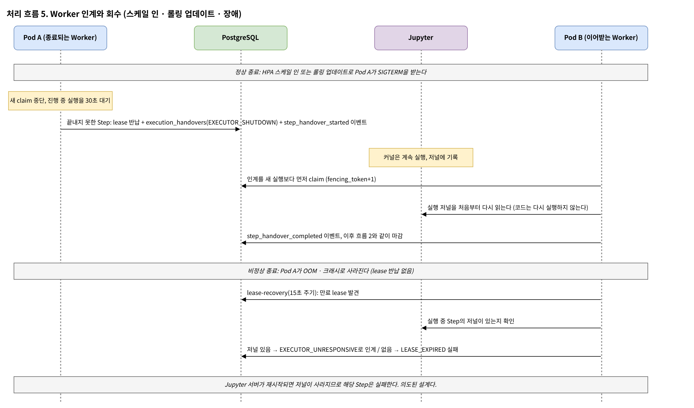
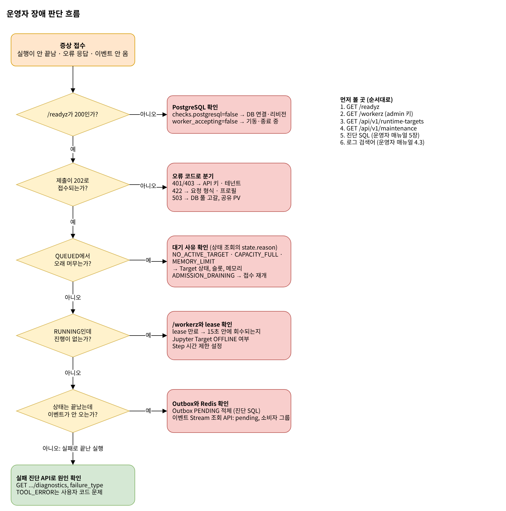
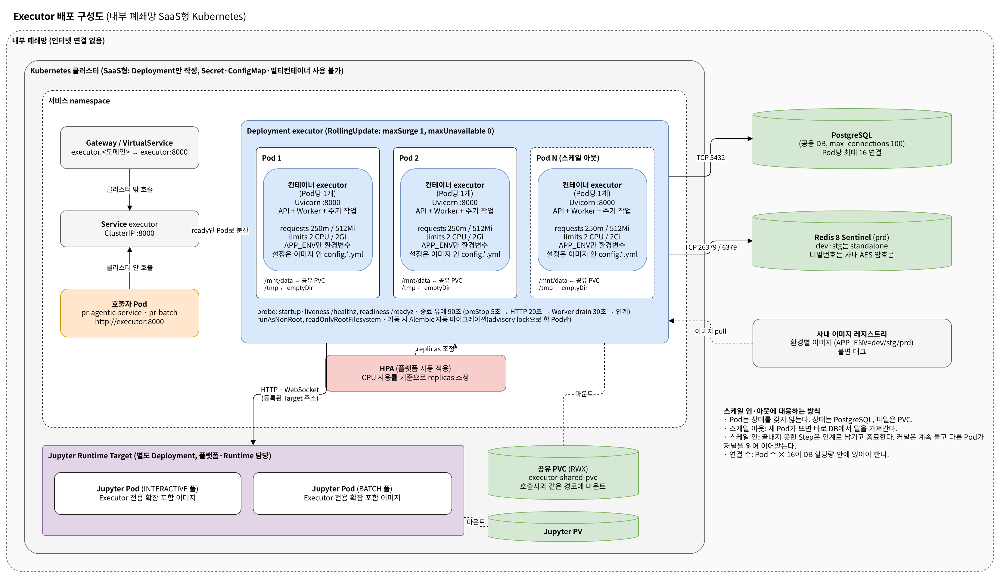

# 운영자 매뉴얼

| 항목 | 내용 |
|---|---|
| 시스템 | Executor (코드 실행 서비스) |
| 산출물 | 8. 운영자 매뉴얼 |
| 버전 | 1.0 |
| 작성일 | 2026-11-25 |
| 기준 | 저장소 `kimhwajin/executor` `main` `3a43a90`, 스키마 리비전 `0017` |

| 버전 | 일자 | 내용 |
|---|---|---|
| 1.0 | 2026-11-25 | 최초 작성 |

Executor를 운영하는 사람이 배포 구성을 이해하고, 상태를 확인하고, 장애를 판단하고, 정해진 운영 작업을 수행할 수 있게 쓴 문서다. 배포 구성과 HPA 대응은 10장, 아직 풀리지 않은 한계는 11장, 담당은 12장에 있다.

## 1. 운영 도구

메트릭 엔드포인트는 없다. 아래 네 가지가 전부다.

| 도구 | 쓰는 법 | 인증 |
|---|---|---|
| 상태 엔드포인트 | `/healthz`(프로세스 생존), `/readyz`(DB와 Worker 상태), `/workerz`(이 Pod의 Worker 내부 상태) | `/workerz`만 admin 키 |
| 관리 API | `/api/v1/runtime-targets`, `/api/v1/runtime-pools`, `/api/v1/maintenance`, `/api/v1/event-streams` | admin 키(`ops`) |
| 실행 조회 API | `/api/v1/executions/{id}` 와 하위 `diagnostics`, `events`, `attempts`, `steps` | 호출자 키 또는 relay 키 + `X-Tenant-Id` |
| 로그 | 표준출력, 평문 한 줄. Runtime 실패만 JSON 한 줄(`"event": "runtime.failure"`) | |
| SQL | PostgreSQL 직접 조회(5장) | 읽기 전용 계정 권장 |

모든 API 요청에 `X-User-Id`가 필요하고, 관리 API의 변경 요청은 본문에 `idempotency_key`를 받는다. 요청에 `X-Request-ID`를 넣어 보내면 오류 로그에 함께 남아 찾기 쉽다.

### 1.1 `/workerz` 읽는 법

| 필드 | 정상 | 이상 |
|---|---|---|
| `state` | `ACCEPTING` | `STARTING`(기동 중), `DRAINING`(종료 중), `STOPPED` |
| `active_execution_count` / `max_active_execution_count` | 여유 있음 | 같으면 이 Pod는 꽉 찼다. 취소 작업은 상한 밖이라 넘을 수 있다 |
| `redis_reachable` | `true` | `false`면 이벤트 발행이 멈춘 상태(실행은 계속됨) |
| `startup_reconciliation.completed_at` | 값 있음 | `null`이면 기동 정리가 끝나지 않았거나 실패 |

`/workerz`는 요청을 받은 Pod 하나만 보여준다. 전체 상황은 `GET /api/v1/maintenance`의 `workload`와 SQL로 본다.

## 2. 부하를 받는 지점

API와 Worker가 한 프로세스라서 **DB 연결 풀, CPU(이벤트 루프 1개), 공유 PV, 스레드 풀**을 나눠 쓴다. 하나가 막히면 다른 쪽도 같이 느려진다. 근거는 2026-11-22 부하 시험 검토다.

| # | 지점 | 증상 | 확인 | 대응 |
|---|---|---|---|---|
| 1 | DB 연결 풀(Pod당 15) | 제출·조회가 느려지다 `503 DATABASE_UNAVAILABLE`. 로그 `Database operation failed; error_type=TimeoutError` | `pg_stat_activity`에서 Executor 연결 수와 `idle in transaction` 비율(5.6) | Pod 수 늘리기(DB 연결 예산 안에서). 풀 크기는 DB 예산과 묶여 있어 함부로 키우지 않는다 |
| 2 | 프로세스 CPU | 실행 처리량이 더 안 늘고 응답 전체가 느려짐. CPU가 1코어 가까이 | Pod CPU | CPU 기반 HPA가 스케일 아웃한다. 호출자의 상태 폴링이 잦으면 그것만으로 CPU를 먹는다. 이벤트 구독을 쓰게 하고 폴링 간격을 늘린다 |
| 3 | 공유 PV 쓰기(fsync) | CPU는 한가한데 제출과 Step 완료가 느림 | 아래 fsync 측정 | **CPU가 안 올라서 HPA가 반응하지 않는다.** 저장소 쪽 문제로 넘긴다 |
| 4 | Runtime 용량 | 실행이 `QUEUED`로 오래 머묾. 대기 사유 `CAPACITY_FULL`, `MEMORY_LIMIT` | `GET /api/v1/runtime-pools`, 실행 상세의 `state.reason` | **Executor Pod를 늘려도 소용없다.** Jupyter 서버를 추가 등록하거나 `max_concurrent_executions`, 메모리 예약값을 조정 |
| 5 | Worker 슬롯(Pod당 20) | 로그 `Executor Worker full; new Executions wait` | `/workerz` | 정상적인 상한. Runtime 여유가 있는데 계속 꽉 차면 Pod를 늘린다 |
| 6 | 같은 Target으로의 claim | 몰릴 때 실행 시작이 줄줄이 늦어짐 | 같은 시각 claim 트랜잭션 지연 | 고른 Target 행을 잠그므로 한 Target으로 가는 시작은 순서대로 처리된다. Target 수를 늘리면 분산된다 |
| 7 | Outbox → Redis | 이벤트가 늦게 도착 | Outbox 적체 SQL(5.4), `/workerz`의 `redis_reachable` | Redis 복구 시 자동 해소. 발행은 Redis 응답을 기다리는 동안 DB 연결을 쥐므로 Redis가 느리면 풀 압박도 커진다 |
| 8 | 큰 출력 | Step이 `OUTPUT_LIMIT_EXCEEDED`로 실패 | 실행 diagnostics | 출력 메시지 하나가 `RUNTIME_MAX_OUTPUT_MESSAGE_BYTES`(32 MiB)를 넘은 것. 코드에서 출력을 줄이거나 파일로 쓰게 한다 |
| 9 | Artifact 다운로드 | 다운로드 중 다른 요청이 느림 | 요청 로그 | Jupyter에서 받아 그대로 흘려보낸다. 최대 `JUPYTER_STORAGE_TIMEOUT_SECONDS`(300초) |

공유 PV fsync 측정(Executor 컨테이너 안에서). 건당 수십 ms 이상이면 3번이 원인이다.

```bash
python -c "
import os,time
d=os.environ.get('STORAGE_ROOT','/mnt/data/dtest')
f=open(d+'/.fsync_probe','wb'); t=time.time()
for _ in range(50): f.write(b'x'); f.flush(); os.fsync(f.fileno())
print(round((time.time()-t)/50*1000,1),'ms/fsync'); f.close(); os.remove(d+'/.fsync_probe')"
```

### 2.1 Pod 수와 부하의 관계

| Pod를 늘리면 | 효과 |
|---|---|
| 동시 실행 상한 | Pod 수 × 20 |
| DB 연결 | Pod 수 × 16. **공용 DB 예산이 상한이다** |
| CPU 병목(2번) | 해소된다 |
| fsync 병목(3번), Runtime 병목(4번) | 해소되지 않는다 |
| 주기 작업(lease 회수, probe, 보존 등) | 늘지 않는다. 클러스터에서 한 Pod만 돈다 |

## 3. 스케일 인·아웃과 재시작 때 일어나는 일



| 상황 | 동작 | 운영자가 알 것 |
|---|---|---|
| Pod 추가 | 새 Pod가 기동 정리 후 1초 주기로 대기 실행을 가져간다. 설정 변경 필요 없음 | 기동 직후 `/workerz`의 `startup_reconciliation` 확인 |
| Pod 정상 종료(스케일 인, 롤링 업데이트) | 새 claim 중단 → 진행 중 실행을 30초 기다림 → 남은 Step은 커널에 둔 채 다른 Pod에 인계 | 사용자 코드는 끊기지 않는다. 이벤트 `execution.step_handover_started` / `_completed`가 나온다 |
| Pod 비정상 종료(OOM, 크래시) | lease(60초) 만료 후 다른 Pod가 회수. 실행 중 Step은 저널로 인계, 인계할 수 없으면 `LEASE_EXPIRED` 실패 | **최대 약 75초(lease 60초 + 회수 주기 15초) 동안 그 실행의 진행이 멈춘 것처럼 보인다** |
| Jupyter 서버 재시작 | 그 서버의 실행 중 Step은 `RUNTIME_SESSION_LOST` 등으로 실패. Target은 probe 실패로 `OFFLINE`, 복구되면 자동으로 `ACTIVE` | Jupyter 재배포 전에는 Target을 `DRAINING`으로 바꾸고 비기를 기다린다(6.2) |
| DB 재시작 | 진행 중 트랜잭션 실패, readiness 실패. 복구 후 lease 회수와 재claim으로 이어감 | 장애가 lease 시간보다 길면 실행 중이던 것들은 인계 또는 실패 처리된다 |
| Redis 재시작 | 이벤트만 쌓였다가 순서대로 발행. 실행은 영향 없음 | 소비자는 중복 이벤트를 받을 수 있다(at-least-once) |

## 4. 장애 진단



### 4.1 처음 볼 곳 (순서대로)

1. **`/readyz`** — `postgresql`이 `false`면 DB 연결 또는 스키마 문제. `worker_accepting`이 `false`면 그 Pod가 기동 중이거나 종료 중.
2. **`GET /api/v1/maintenance`** — `admission.state`가 `DRAINING`이면 누군가 전체 접수를 멈췄다. 새 실행은 `QUEUED`로만 쌓인다.
3. **`GET /api/v1/runtime-pools`** — 풀별 Target 수, 상태, 남은 용량.
4. **`GET /api/v1/runtime-targets`** — Target별 `status`, `last_health_error`, 사용 슬롯, CPU·메모리 관측과 관측 시각.
5. **실행 하나를 볼 때** — `GET /api/v1/executions/{id}`의 `state.status`와 `state.reason` → `.../diagnostics`(실패 원인과 부수 오류) → `.../events`(타임라인) → `.../attempts`(시도별 Worker, Target, 실패 원인).
6. **이벤트가 안 온다고 할 때** — `GET /api/v1/event-streams/{tenant_id}`(Stream 길이, 마지막 항목, 소비자 그룹) → `.../groups/{group}/pending`(소비자가 ACK하지 않은 항목). Executor가 발행했는지 소비자가 안 읽었는지를 가른다.

### 4.2 증상별 판단

| 증상 | 먼저 볼 것 | 원인 후보 | 조치 |
|---|---|---|---|
| 실행이 계속 `QUEUED` | `state.reason.code` | `ADMISSION_DRAINING`: 전체 drain 중 / `NO_ACTIVE_TARGET`: 해당 풀에 ACTIVE Target 없음 / `PROFILE_UNSUPPORTED`: 프로필을 지원하는 Target 없음 / `CAPACITY_FULL`: 슬롯 소진 / `MEMORY_LIMIT`: 배정 가능 메모리 부족 / `TARGET_UNAVAILABLE`: 이 실행의 커널 세션을 가진 Target(MULTI, 보존 세션 재시도)이 OFFLINE이거나 disabled / `WAITING_FOR_WORKER`: Target은 있는데 Worker가 아직 못 가져감 | 사유에 맞게 activate, Target 추가, 용량 조정. `WAITING_FOR_WORKER`가 오래가면 Worker 슬롯 포화나 DB 풀 포화(2장 1, 5번) |
| 24시간 뒤 `FAILED / QUEUE_TIMEOUT` | 위와 같음 | 한 번도 시작 못함 | 원인 해소 후 호출자가 다시 제출 |
| `RUNNING`인데 진행이 없음 | `.../events` 마지막 이벤트, SQL 5.2 | 담당 Pod가 죽어 lease 만료 대기, 사용자 코드가 오래 걸림, Jupyter 연결 끊김 | lease 만료 후 자동 회수된다. `state.reason.code`가 `WORKER_HANDOVER`면 인계 대기 |
| `FAILED / TOOL_ERROR` | Step 결과(manifest의 error 출력) | 사용자 코드 예외 | 서비스 문제 아님. 1시간 안에 `FROM_FAILED_STEP` 재시도 가능 |
| `FAILED / RUNTIME_UNAVAILABLE`, `RUNTIME_SESSION_LOST` | diagnostics, Target `last_health_error` | Jupyter 서버 장애·재시작, 커널 OOM | Jupyter 쪽 로그와 메모리 확인 |
| `FAILED / LEASE_EXPIRED`, `WORKER_SHUTDOWN` | attempts의 `lease_owner`(Pod 이름) | Executor Pod가 죽었고 인계할 저널이 없었음 | 같은 시각 Pod 재시작 사유(OOM 등) 확인 |
| `FAILED / STEP_TIMEOUT`, `OPERATION_TIMEOUT` | diagnostics의 `runtime_abort_status` | 요청한 시간 한도 초과 | 호출자 한도 조정 |
| `FAILED / COMPLETION_FAILED`, `INFRASTRUCTURE_ERROR` | diagnostics, 로그 `runtime.failure` | 결과 저장 실패(공유 PV), 노트북 반영 실패 | 공유 PV 상태와 용량 |
| 제출이 `503 DATABASE_UNAVAILABLE` | 로그, SQL 5.6 | DB 장애 또는 풀 포화 | 2장 1번 |
| 제출이 느림(수 초) | fsync 측정, CPU | 2장 2, 3번 | |
| 이벤트 지연·누락 | `/workerz` `redis_reachable`, SQL 5.4, event-streams API | Redis 장애, 소비자 미ACK | Outbox에 남아 있으면 Executor 쪽, Stream에 있으면 소비자 쪽 |
| Target이 `OFFLINE` | Target `last_health_error`, `POST .../probe` | Jupyter 다운, 토큰 불일치, 네트워크 | 복구되면 다음 probe(15초)에 자동 ACTIVE |
| 로그 `Runtime session count exceeds durable reservations` | `GET .../runtime-targets/{id}/kernels` | Executor가 모르는 커널이 Jupyter에 떠 있음(수동 생성, 정리 실패) | 해당 Target 배정이 막힌다. 남겨진 커널을 6.6으로 지운다 |
| Pod가 Ready가 안 됨 | 기동 로그 | 마이그레이션 실패, lock 대기, `RUNTIME_CREDENTIAL_KEY` 자리표시자, 설정 파일 누락 | 로그 `Database migration failed`, `Executor startup reconciliation failed` |

### 4.3 로그 검색어

| 로그 | 수준 | 뜻 |
|---|---|---|
| `"event": "runtime.failure"` | ERROR | Runtime 관련 실패. JSON에 `phase`, `execution_id`, `attempt_id`, `target_id`, 예외 체인 |
| `Executor Worker full; new Executions wait` / `has free slots again` | WARN / INFO | 이 Pod의 슬롯 포화 시작과 끝 |
| `Runtime admission blocked pool=… reason=…` / `Runtime admission resumed` | WARN / INFO | 배정 불가 시작과 끝. `targets=`에 Target별 수치 |
| `Execution Worker lost its lease fence; stale results were discarded` | WARN | 다른 Worker나 취소가 소유권을 가져감. 취소 경합에서는 정상 |
| `Lease heartbeat failed; retrying next interval` | WARN | lease 갱신 실패. 계속되면 DB 문제 |
| `Executor Worker drain deadline exceeded; cancelling remaining jobs` | WARN | 종료 시 30초 안에 못 끝난 실행을 인계로 넘김 |
| `Runtime session cleanup exceeded the Worker shutdown deadline` | WARN | 종료 중 커널 정리 시간 초과. 정리 재시도 작업이 이어받는다 |
| `Outbox publish failed event_id=…` / `Outbox polling failed` | WARN / ERROR | Redis 발행 실패 / DB 조회 실패 |
| `Runtime Target health probe failed` / `resource probe failed` | WARN | Jupyter health·자원 관측 실패 |
| `Runtime storage read/write failed; trying another shared-storage target` | WARN | 노트북·Artifact 접근 실패, 같은 풀의 다른 Target으로 재시도 |
| `Database operation failed; error_type=… sqlstate=…` | ERROR | DB 오류(SQL·값은 가려짐). `TimeoutError`는 풀 대기 초과 |
| `Event retention pass failed`, `Event Stream trimming skipped` | ERROR / WARN | 보존 정리 실패 |
| `Database migration failed`, `Executor startup reconciliation failed` | ERROR | 기동 실패 |

## 5. 진단 SQL

읽기 전용이다. 상태값은 대문자 문자열이다.

### 5.1 상태별 적체

```sql
SELECT status, runtime_pool, count(*), min(created_at) AS oldest
FROM executions
WHERE status NOT IN ('SUCCEEDED','FAILED','CANCELLED')
GROUP BY status, runtime_pool
ORDER BY status, runtime_pool;
```

### 5.2 lease가 만료된 채 RUNNING (회수 대기)

```sql
SELECT id, lease_owner, lease_expires_at, now() - lease_expires_at AS overdue
FROM executions
WHERE status = 'RUNNING' AND lease_expires_at < now()
ORDER BY lease_expires_at;
```

몇십 초 안에 사라져야 정상이다. 계속 남으면 lease-recovery 작업이 돌지 않는 것이므로 5.5를 본다.

### 5.3 Target별 사용 중 슬롯

```sql
SELECT t.name, t.status, t.enabled, t.max_concurrent_executions,
       t.active_session_count, t.memory_utilization, t.cpu_utilization,
       t.resource_observed_at,
       count(a.id) FILTER (WHERE a.status IN ('RUNNING','WAITING')) AS reserved
FROM runtime_targets t
LEFT JOIN execution_attempts a ON a.runtime_target_id = t.id
GROUP BY t.id
ORDER BY t.pool, t.name;
```

`reserved`에는 재시도용 보존 세션과 정리 대기 세션이 빠져 있다. 정확한 값은 `GET /api/v1/runtime-targets`.

### 5.4 Outbox 적체

```sql
SELECT count(*) AS pending, min(created_at) AS oldest, max(attempt_count) AS max_attempts,
       max(last_error) AS sample_error
FROM outbox_events
WHERE status = 'PENDING';
```

### 5.5 주기 작업이 돌고 있는가

```sql
SELECT singleton_key, lease_owner, last_started_at, last_completed_at, last_error
FROM event_retention_lease
ORDER BY singleton_key;
```

`last_started_at`이 주기(대부분 15초, `events`는 10분)보다 오래됐으면 그 작업이 멈췄다.

### 5.6 DB 연결 사용

```sql
SELECT state, count(*), max(now() - state_change) AS longest
FROM pg_stat_activity
WHERE datname = current_database() AND usename = current_user
GROUP BY state;
```

`idle in transaction`이 많으면 앱이 연결을 쥔 채 다른 일을 하고 있다는 뜻이다(DB가 느린 게 아니다).

### 5.7 테이블 크기

```sql
SELECT relname, n_live_tup, pg_size_pretty(pg_total_relation_size(relid)) AS size
FROM pg_stat_user_tables
ORDER BY pg_total_relation_size(relid) DESC
LIMIT 10;
```

## 6. 운영 작업

모든 변경 요청은 admin 키와 `X-User-Id`, 본문 `idempotency_key`가 필요하다(DELETE 제외).

### 6.1 Runtime Target 추가

1. Jupyter 서버를 Executor 확장이 들어간 이미지로 띄운다. 공유 저장소 마운트를 같은 풀의 다른 서버와 맞춘다.
2. `POST /api/v1/runtime-targets`: `name`, `runtime_type: JUPYTER`, `connection_config: {"endpoint": "..."}`, `credential`(Jupyter 토큰), `pool`, `max_concurrent_executions`(생략 시 20).
3. 응답이 `ACTIVE`이고 `supported_profiles`가 채워졌는지 확인. 대기 중이던 실행은 자동으로 배정된다.

같은 endpoint는 한 번만 등록된다(`409 RUNTIME_TARGET_ENDPOINT_CONFLICT`). 값을 바꿀 때는 같은 `name`으로 다시 보낸다.

### 6.2 Runtime Target 빼기 (Jupyter 재배포 포함)

1. `POST .../{id}/drain` → 새 배정 중단. 실행 중인 것은 계속된다.
2. `GET .../{id}`에서 `drain_complete=true`를 기다린다. 재시도용 보존 세션(최대 1시간)도 자리를 잡고 있다.
3. 재배포만 할 거면 재배포 후 `POST .../{id}/activate`. 아예 뺄 거면 `POST .../{id}/disable` 후 Jupyter를 내리고, 필요하면 `DELETE .../{id}`로 등록을 지운다(이력은 남는다).

**Jupyter를 먼저 내리지 않는다.** 실행 중이던 Step이 모두 실패한다.

### 6.3 Executor 전체 접수 중단과 재개

- `POST /api/v1/maintenance/drain`: 모든 Pod가 새 실행 시작을 멈춘다. 제출은 계속 받아 `QUEUED`로 쌓는다. 실행 중인 것과 취소는 계속된다.
- `GET /api/v1/maintenance`의 `safe_to_shutdown=true`가 되면 실행 중·취소 중·정리 대기가 모두 없다.
- `POST /api/v1/maintenance/activate`: 재개. 쌓인 실행이 바로 시작된다.
- 실행 중인 것까지 멈춰야 하면 `POST /api/v1/maintenance/runs`(`action: STOP_ACTIVE_EXECUTIONS`)로 일괄 중지 Run을 만들고 `GET .../runs/{id}`로 진행을 본다. Run을 만들면 접수 상태도 자동으로 `DRAINING`이 된다.

DB 점검, 스키마 축소 마이그레이션처럼 Executor 전체를 멈춰야 할 때 쓴다. 일반 롤링 업데이트에는 필요 없다(3장).

### 6.4 API 키 교체

1. `scripts/generate_api_keys.py`로 새 키와 해시를 만든다.
2. 해당 `AUTH_CLIENTS[].key_sha256`에 새 해시를 **추가**해 배포한다(신·구 공존).
3. 호출 서비스가 새 키로 바꾼 뒤 구 해시를 지워 다시 배포한다.

### 6.5 배포 순서

- Executor와 Jupyter 확장을 함께 바꾸는 변경은 **Jupyter 확장을 먼저** 배포한다. 확장 없이 Executor는 코드를 시작하지 못한다(404).
- 스키마 변경이 있는 릴리스는 새 Pod 하나가 기동 시 마이그레이션한다. 구 Pod는 새 스키마에서도 ready를 유지한다(리비전 "이상" 비교).
- 컬럼 삭제 같은 축소 마이그레이션이 든 릴리스는 6.3으로 drain 후 전체 교체한다.

### 6.6 남겨진 커널 삭제

Worker가 커널을 만든 직후, 커널 ID를 기록하기 전에 죽으면 어느 실행도 잡고 있지 않은 커널이 남는다. Jupyter가 재시작될 때까지 메모리를 차지한다.

1. `GET /api/v1/runtime-targets/{id}/kernels`: 커널별 메모리·CPU와 그 커널을 쓰는 실행을 본다. `execution_id`가 `null`이면 남겨진 커널이다.
2. `DELETE /api/v1/runtime-targets/{id}/kernels/{kernel_id}`: 지운다. `204`면 지웠거나 이미 없다.
3. 실행이 잡고 있거나 15분 안에 활동한 커널은 `409 RUNTIME_KERNEL_DELETE_CONFLICT`로 거부된다. 실행이 잡은 커널은 그 실행을 취소해서 정리한다.

지운 커널은 로그에 `Deleted unheld Runtime kernel`로 남는다. 이 기능은 그 Jupyter를 이 Executor만 쓴다는 전제에서 안전하다.

### 6.7 실행별 자원 사용량 확인

`GET /api/v1/executions/{id}/kernel-usage`는 실행이 쓰는 커널의 지금 메모리·CPU와, 끝난 Step 시도마다 기록된 최대 메모리·CPU 시간을 준다. 메모리 예약값(`RUNTIME_PROFILE_MEMORY_RESERVE_BYTES`)을 정할 때 근거로 쓴다.

## 7. 하면 안 되는 것

| 하지 말 것 | 이유 |
|---|---|
| `RUNTIME_CREDENTIAL_KEY` 변경 | 등록된 Target 토큰을 모두 복호화하지 못한다. 바꾸려면 Target을 전부 다시 등록 |
| stg·prd에서 `DOCS_ENABLED`, `MCP_ENABLED` 켜기 | 내부망 규정. 기본 설정 파일이 끈다 |
| 승인 없이 `REST_ERROR_BODY_LOGGING_ENABLED` 켜기 | 오류 요청 본문(코드 포함)이 마스킹 없이 로그에 남는다 |
| DB에서 `executions`의 status, lease, fencing 컬럼 직접 수정 | 실행 중 Worker와 충돌한다. 멈추려면 취소 API나 6.3을 쓴다 |
| 공유 PV의 `executor/executions/` 아래 파일 수정·이동 | 결과는 sha256으로 검증되므로 조회가 실패한다 |
| 실행 중인 Jupyter 서버를 drain 없이 재시작 | 3장 |
| Jupyter에서 Executor가 만든 커널을 손으로 지우기 | 실행이 `RUNTIME_SESSION_LOST`로 실패하고, 보존 세션이면 재시도가 불가능해진다. 남겨진 커널은 6.6의 API로만 지운다 |
| DB 풀 크기만 키우기 | Pod 수 × 연결 수가 공용 DB 예산을 넘는다 |

## 8. 데이터 정리 (현재 수동)

이벤트, 발행된 Outbox, Redis Stream은 자동 정리된다(이벤트 90일, Outbox와 Stream 7일). 그 밖의 실행 테이블, 공유 PV 결과, Jupyter 작업공간은 지우는 기능이 없다. 용량이 문제 되면 5.7로 크기를 보고 정리 정책을 정해야 한다. 정책 없이 손으로 지우지 않는다(실행 행과 파일이 서로를 가리킨다).

## 9. 주요 설정 (운영 중 조정 대상)

| 설정 | 기본 | 언제 바꾸나 |
|---|---|---|
| `EXECUTION_WORKER_MAX_ACTIVE` | 20 | Pod당 동시 실행. 늘리면 DB 연결 사용도 는다 |
| `DATABASE_POOL_SIZE` / `MAX_OVERFLOW` | 5 / 10 | DB 예산과 함께만 |
| `RUNTIME_DEFAULT_MAX_CONCURRENT_EXECUTIONS` | 20 | Target 등록 시 생략한 슬롯 수. 서버 메모리 ÷ 커널 최대 사용량 |
| `RUNTIME_MEMORY_ADMISSION_LIMIT` | 0.9 | 메모리 배정 한도 비율 |
| `RUNTIME_KERNEL_MEMORY_RESERVE_BYTES` / `RUNTIME_PROFILE_MEMORY_RESERVE_BYTES` | 512 MiB / {} | 무거운 프로필만 크게 |
| `RUNTIME_MAX_OUTPUT_MESSAGE_BYTES` | 32 MiB | 운영값 미확정 |
| `FAILED_SESSION_RETENTION_SECONDS` | 3600 | 실패 커널 보존. 길면 슬롯을 오래 잡는다 |
| `EXECUTION_QUEUE_TIMEOUT_SECONDS` | 86400 | 시작 못한 실행의 최대 대기 |
| `EXECUTION_MAX_RUNTIME_SECONDS` | 604800 | 실행 최대 수명 |
| `EXECUTION_LEASE_SECONDS` / `HEARTBEAT_SECONDS` | 60 / 15 | 장애 감지 속도. 줄이면 DB 쓰기가 는다 |
| `REDIS_EVENT_STREAM_MAXLEN` | 없음 | Redis 메모리가 부족하면 지정 |

전체 목록과 설명은 저장소 `config.example.yml`.

## 10. 배포 구성과 HPA



### 10.1 배포 단위

| 항목 | 내용 |
|---|---|
| 형태 | Deployment `executor` 하나. Pod당 컨테이너 1개, 프로세스 1개(API + Worker + 주기 작업). 멀티컨테이너를 쓰지 않는다 |
| 이미지 | 환경별로 따로 빌드한다(`docker build --build-arg APP_ENV=prd .`). 이미지에 `config.yml`과 그 환경의 `config.{APP_ENV}.yml`만 들어간다 |
| 설정 | 우선순위는 환경변수 → `config.{APP_ENV}.yml` → `config.yml` → 코드 기본값. Deployment는 `APP_ENV`만 준다 |
| 비밀값 | 플랫폼에 Secret이 없어 `config.{APP_ENV}.yml`에 들어간다: `DATABASE_URL`, `REDIS_URL` 또는 `REDIS_SENTINEL_*`, `RUNTIME_CREDENTIAL_KEY`, `AUTH_CLIENTS[].key_sha256`. 값을 문서나 티켓에 적지 않는다 |
| 자원 | requests 250m / 512Mi, limits 2 CPU / 2Gi |
| probe | startup·liveness `/healthz`, readiness `/readyz` |
| 종료 | 유예 90초. preStop 5초 → HTTP 20초 → Worker drain 30초 → 인계 → Outbox 10초 |
| 볼륨 | 공유 PVC를 `/mnt/data`에(호출자와 같은 경로), `/tmp`는 emptyDir |

### 10.2 HPA가 Pod 수를 바꿀 때

플랫폼이 CPU 사용률 기준 HPA를 자동으로 건다. Executor는 Pod가 상태를 갖지 않게 만들어져 있어 Pod 수 변화에 따로 대응할 것이 없다. 운영자가 알아야 할 것은 다음 네 가지다.

| 항목 | 내용 |
|---|---|
| HPA가 반응하는 병목 | 프로세스 CPU(2장 2번). 이벤트 루프가 하나라 Pod당 1코어 근처에서 포화한다 |
| HPA가 반응하지 않는 병목 | 공유 PV 쓰기 지연(2장 3번), Runtime 용량(4번), DB 연결 풀(1번). CPU가 오르지 않으므로 Pod가 늘지 않고, 늘어도 해소되지 않는다 |
| 최대 Pod 수 | Pod 수 × 16 연결이 공용 DB에서 Executor 몫 안에 들어야 한다. HPA의 maxReplicas를 이 값 이하로 플랫폼에 요청한다 |
| 스케일 인 중 실행 | 끊기지 않는다. 끝내지 못한 Step은 다른 Pod가 이어받는다(3장). 이벤트 `execution.step_handover_started`·`_completed`가 나오는 것이 정상이다 |

### 10.3 처음 배포할 때

1. PostgreSQL 데이터베이스와 계정, Redis(8.0 이상, `PING`·`XADD`·`XTRIM` 허용), 공유 PVC(RWX)를 플랫폼에서 받는다.
2. `scripts/generate_api_keys.py <env>`로 호출자별 키를 만들고 해시를 `config.{env}.yml`의 `AUTH_CLIENTS`에 넣는다.
3. `RUNTIME_CREDENTIAL_KEY`(Fernet 키)를 만들어 넣는다. **이후 바꾸지 않는다**(7장).
4. 환경별 이미지를 빌드해 사내 레지스트리에 올리고 Deployment를 적용한다. 첫 Pod가 스키마를 만든다.
5. `/readyz`가 200이 되면 admin 키로 Jupyter 서버를 등록한다(6.1). Executor는 Target 없이 시작한다.
6. 스모크 실행을 하나 제출해 `SUCCEEDED`까지 확인한다.

## 11. 알려진 한계

| 한계 | 내용 | 운영 대응 |
|---|---|---|
| 실행 데이터 무기한 누적 | `executions` 계열 테이블, 공유 PV 결과 파일, Jupyter 작업공간을 지우는 기능이 없다 | 5.7로 크기를 주기적으로 확인한다. 정리 정책이 정해지기 전에는 손으로 지우지 않는다 |
| 메트릭 없음 | `/metrics`가 없다 | 로그, `/workerz`, 관리 API, 진단 SQL로 관측한다 |
| 출력 상한 미확정 | `RUNTIME_MAX_OUTPUT_MESSAGE_BYTES` 32 MiB는 기본값이며 운영값으로 승인되지 않았다 | `OUTPUT_LIMIT_EXCEEDED` 발생 빈도를 보고 정한다 |
| 버려진 임시 결과 디렉터리 | 죽은 Worker가 남긴 `<fencing>.partial` 디렉터리가 공유 PV에 남는다 | 용량에만 영향이 있다. 결과 조회에는 영향이 없다 |

## 12. 담당

| 영역 | 담당 | 연락처 |
|---|---|---|
| Executor 서비스 | (작성 필요) | |
| PostgreSQL | (작성 필요) | |
| Redis | (작성 필요) | |
| Jupyter Runtime | (작성 필요) | |
| Kubernetes 플랫폼 | (작성 필요) | |
